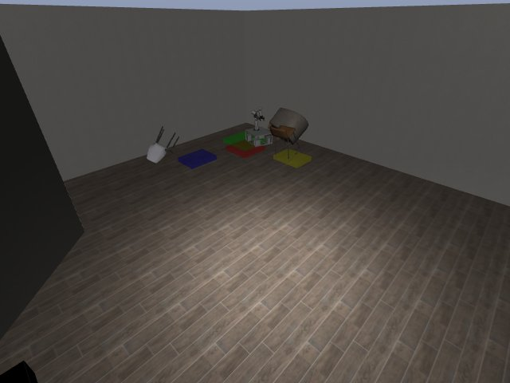

# Codex + GPT-6 Luna, effort medium — kinder-dynamo-i00-standard

Recorded 2026-10-01 under protocol v1.0 (Harbor job `k-luna-dynamo-std`, trial `kinder-dynamo-i00-standard__YGGmkra`). Since then the instruction has had one small fix (`"error"` added to the reasons an episode can end with); the task is otherwise unchanged.

| | |
|---|---|
| result | **1 (success)** |
| mode | standard (`eai-standard/2.1`); reset budget 0 (the standard configuration); sensors: the robot cameras, wrist depth, odometry, joint encoders |
| agent | Harbor's `codex` agent, Codex 0.159.2, `openai/gpt-6-luna` through OpenRouter, reasoning effort medium, web search disabled (`scripts/kinder/configs/codex-openrouter.yaml`) |
| budget | 60 min; tokens 100M in / 10M out (PROTOCOL D10) |
| agent time | 566 s |
| tokens in / out | 2,956,268 / 22,906 (within the budget) |
| cost | $0.05 |
| verifier | `{"success": 1, "live_success": 1, "replay_success": 1, "deterministic": 1, "finalized": 1, "missing_log": 0, "infra_error": 0, "grader_error": 0, "sim_crashed_on_call": 0, "n_actions": 376, "sim_steps": 376, "calls": 49, "rows": 376, "resets": 0, "sim_startups": 2, "elapsed_s": 488.9, "video_rendered": 1}` |

`trajectory.npz` is the graded trajectory (the sidecar's record of the episode): a positive example for this task's human review (PROTOCOL §2.7).

## What happened

Drove the base by its cameras and odometry in chunks of up to 10 rows (49 calls) and reached the square at step 376 of its only episode. The sidecar was crashed on purpose mid-episode (SIGINT to the server, 5.4 min into the run) to test recovery: compose restarted it, it replayed its 233-step journal, matched the state hash and resumed the same episode (sim_startups = 2); the agent continued and passed.
