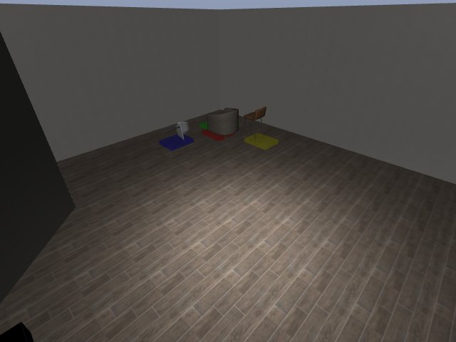

# Codex + GPT-6 Luna, effort medium — kinder-dynamo-i00-standard

Recorded 2026-09-30 before protocol v1.0 (Harbor job `kinder-limited-dynamo-codex-gpt6luna-medium-60min-reset0-depth-ee`, trial `kinder-dynamo-i00-limited__W3PhvsA`). Not an official v1.0 result: the run went through the repository's former OpenRouter adapter (`harbor_agents/`, removed under PROTOCOL D11), and on the task as it then was.

| | |
|---|---|
| result | **0** |
| mode | standard; reset budget 0 (resets used: 0); sensors: cams+proprio+depth |
| task version | rcb-limited/1.1, the protocol before v1.0: one action or a batch per `POST /step`, base64 images, `POST /reset` within a budget; this task now speaks eai-standard/2.1, so its instruction and client differ from what this run had. The scene, sensors, actions and success check are the same. |
| agent | Codex 0.159.2 via OpenRouter, `openai/gpt-6-luna`, reasoning effort medium, web search off |
| budget | 60 min; tokens 100M in / 10M out (PROTOCOL D10) |
| agent time | 367 s |
| tokens in / out | 2,653,201 / 23,206 (within the budget) |
| cost | $0.04 |
| verifier | `{"success": 0, "missing_log": 0, "live_success": 0, "replay_success": 0, "deterministic": 1, "finalized": 1, "n_actions": 1000, "sim_steps": 1000, "steps": 1000, "resets": 0, "elapsed_s": 376.0, "video_rendered": 1, "grader_error": 0}` |

## What happened

base camera only, arm never moved; blind 30-step lane sweeps after step 188, square never seen; ep0 failed at step 1000 (6.1 min)
