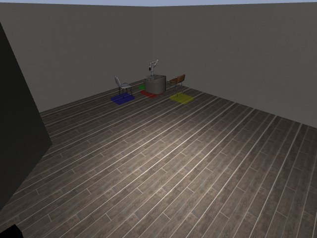

# Codex + GPT-6 Luna, effort medium — kinder-dynamo-i00

Recorded 2026-10-01 under protocol v1.0 (Harbor job `k-luna-dynamo`, trial `kinder-dynamo-i00__uQSVugk`).

| | |
|---|---|
| result | **1 (success)** |
| mode | privileged |
| agent | Harbor's `codex` agent, Codex 0.159.2, `openai/gpt-6-luna` through OpenRouter, reasoning effort medium, web search disabled (`scripts/kinder/configs/codex-openrouter.yaml`) |
| budget | 60 min; tokens 100M in / 10M out (PROTOCOL D10) |
| agent time | 216 s |
| tokens in / out | 328,067 / 7,567 (within the budget) |
| cost | $0.01 |
| verifier | `{"success": 1, "all_success": 1, "deterministic": 1, "n_actions": 577, "sim_steps": 577, "missing_trajectory": 0, "invalid_trajectory": 0, "grader_error": 0, "video_rendered": 1}` |

`trajectory.npz` is the graded trajectory (the agent's deliverable): a positive example for this task's human review (PROTOCOL §2.7).

## What happened

Read the scene's state, planned a route around the chairs with the goal check in the loop, and saved a trajectory that reaches the square at step 577; two fresh-process replays agreed. The first run of this task under protocol v1.0 (Harbor's own Codex agent).
