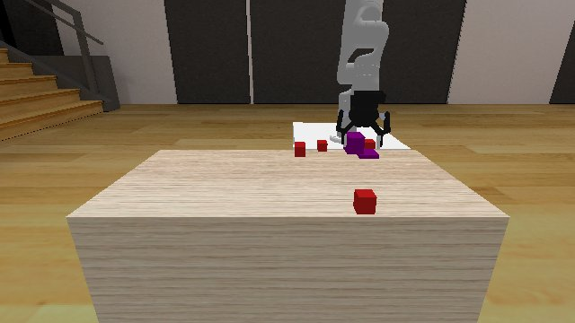

# Codex + GPT-6 Luna, effort medium — kinder-obstruction-3d-i00-standard

Recorded 2026-10-01 under protocol v1.0 (Harbor job `n0-kinder-standard`, trial `kinder-obstruction-3d-i00-standa__JGwMXHt`).

| | |
|---|---|
| result | **0** |
| mode | standard (`eai-standard/2.1`); reset budget 0 (the standard configuration); sensors: the robot cameras, wrist depth, odometry, joint encoders |
| agent | Harbor's `codex` agent, Codex 0.159.2, `openai/gpt-6-luna` through OpenRouter, reasoning effort medium, web search disabled (`scripts/kinder/configs/codex-openrouter.yaml`) |
| budget | 60 min; tokens 100M in / 10M out (PROTOCOL D10) |
| agent time | 3602 s |
| tokens in / out | 35,490,507 / 215,918 (within the budget) |
| cost | $0.53 |
| verifier | `{"success": 0, "live_success": 0, "replay_success": 0, "deterministic": 1, "finalized": 1, "missing_log": 0, "infra_error": 0, "grader_error": 0, "sim_crashed_on_call": 0, "n_actions": 291, "sim_steps": 291, "calls": 205, "rows": 291, "resets": 0, "reset_budget": 0, "sim_startups": 1, "elapsed_s": 3594.3, "video_rendered": 1}` |

## What happened

First move within a minute of its first request (after 2 free looks), then 181 chunks of 1–12 rows (linear, dt 0.1 s). The episode was still running at control step 291 of 3000 when its 60 min ran out (timeout).
