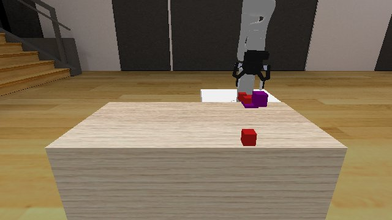

# Codex + GPT-6 Luna, effort medium — kinder-obstruction-3d-i00-standard

Recorded 2026-09-30 before protocol v1.0 (Harbor job `kinder-limited-obstruction-3d-codex-gpt6luna-medium-60min-reset0-depth-ee`, trial `kinder-obstruction-3d-i00-limite__xEYNCCa`). Not an official v1.0 result: the run went through the repository's former OpenRouter adapter (`harbor_agents/`, removed under PROTOCOL D11), and on the task as it then was.

| | |
|---|---|
| result | **0** |
| mode | standard; reset budget 0 (resets used: 0); sensors: cams+proprio+depth |
| task version | rcb-limited/1.1, the protocol before v1.0: one action or a batch per `POST /step`, base64 images, `POST /reset` within a budget; this task now speaks eai-standard/2.1, so its instruction and client differ from what this run had. The scene, sensors, actions and success check are the same. |
| agent | Codex 0.159.2 via OpenRouter, `openai/gpt-6-luna`, reasoning effort medium, web search off |
| budget | 60 min; tokens 100M in / 10M out (PROTOCOL D10) |
| agent time | 3603 s |
| tokens in / out | 56,031,455 / 177,739 (within the budget) |
| cost | $0.71 |
| verifier | `{"success": 0, "missing_log": 0, "live_success": 0, "replay_success": 0, "deterministic": 1, "finalized": 1, "n_actions": 163, "sim_steps": 163, "steps": 163, "resets": 0, "elapsed_s": 3608.8, "video_rendered": 1, "grader_error": 0}` |

## What happened

one step per tool call (163 in 60 min); purple grasped first try, 10 blocked descents onto crowded pad, 3 empty red grasps; timeout
