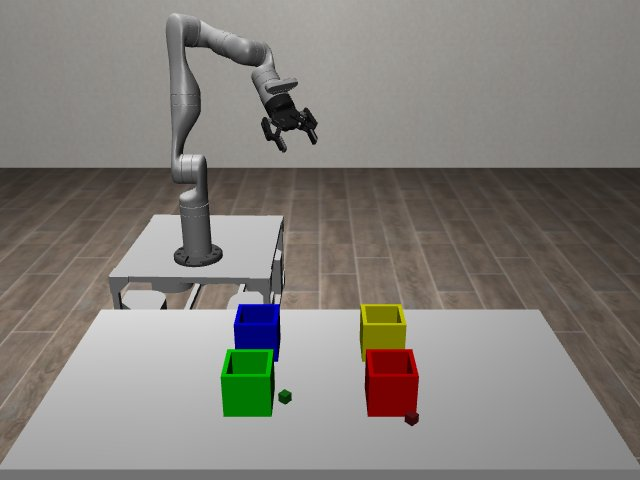

# Codex + GPT-6 Luna, effort medium — kinder-sort-blocks-i00-standard

Recorded 2026-10-01 under protocol v1.0 (Harbor job `r50-kinder-standard`, trial `kinder-sort-blocks-i00-standard__ygMKu8H`).

| | |
|---|---|
| result | **0** |
| mode | standard (`eai-standard/2.1`); reset budget 50 (the optional reset capability, PROTOCOL D1: reported separately from runs without reset); sensors: the robot cameras, wrist depth, odometry, joint encoders |
| agent | Harbor's `codex` agent, Codex 0.159.2, `openai/gpt-6-luna` through OpenRouter, reasoning effort medium, web search disabled (`scripts/kinder/configs/codex-openrouter.yaml`) |
| budget | 60 min; tokens 100M in / 10M out (PROTOCOL D10) |
| agent time | 3603 s |
| tokens in / out | 20,112,622 / 183,368 (within the budget) |
| cost | $0.35 |
| verifier | `{"success": 0, "live_success": 0, "replay_success": 0, "deterministic": 1, "finalized": 1, "missing_log": 0, "infra_error": 0, "grader_error": 0, "sim_crashed_on_call": 0, "n_actions": 723, "sim_steps": 11893, "calls": 16736, "rows": 11893, "resets": 17, "reset_budget": 50, "sim_startups": 1, "elapsed_s": 3591.4, "video_rendered": 1}` |

## What happened

First move within a minute of its first request; 8124 chunks in all, 11893 control steps over 18 episodes (17 of its 50 resets used). Of the episodes before the last, 3 used all 1000 steps, 14 abandoned by a reset while running. The graded episode 18 was still running at its control step 723 when its 60 min ran out (timeout).
