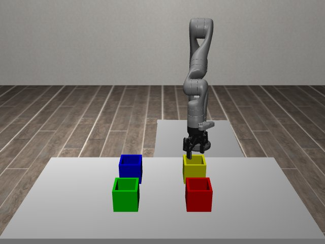

# Codex + GPT-6 Luna, effort medium — kinder-sort-blocks-i00

Recorded 2026-09-29 before protocol v1.0 (Harbor job `kinder-full-sort-blocks-codex-gpt6luna-medium-60min`, trial `kinder-sort-blocks-i00__ETDNYZ7`). Not an official v1.0 result: the run went through the repository's former OpenRouter adapter (`harbor_agents/`, removed under PROTOCOL D11), and on the task as it then was.

| | |
|---|---|
| result | **1 (success)** |
| mode | privileged |
| task version | before protocol v1.0, which changed only this task's metadata and image name: the instruction it was given is an earlier wording of today's; the scene and verifier are the same. |
| agent | Codex 0.159.0 via OpenRouter, `openai/gpt-6-luna`, reasoning effort medium, web search off |
| budget | 60 min; tokens 100M in / 10M out (PROTOCOL D10) |
| agent time | 2555 s |
| tokens in / out | 10,301,722 / 137,153 (within the budget) |
| cost | $0.20 |
| verifier | `{"success": 1, "all_success": 1, "deterministic": 1, "n_actions": 1000, "sim_steps": 1000, "missing_trajectory": 0, "invalid_trajectory": 0, "grader_error": 0, "video_rendered": 1}` |

`trajectory.npz` is the graded trajectory (the agent's deliverable): the positive example this task's human review checks (PROTOCOL §2.7).

## What happened

true state + pinch-site IK; per-cube jaw angles, two base stations, high drops over bins; success at step 1000 of 1000
