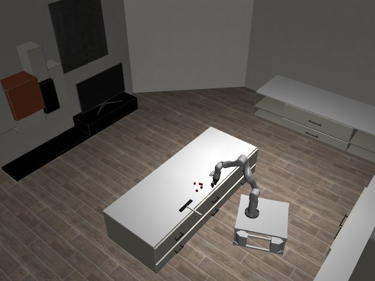

# Codex + GPT-6 Luna, effort medium — kinder-sweep-into-drawer-i00-standard

Recorded 2026-10-01 under protocol v1.0 (Harbor job `n0-kinder-standard`, trial `kinder-sweep-into-drawer-i00-sta__9Hoywrf`).

| | |
|---|---|
| result | **0** |
| mode | standard (`eai-standard/2.1`); reset budget 0 (the standard configuration); sensors: the robot cameras, wrist depth, odometry, joint encoders |
| agent | Harbor's `codex` agent, Codex 0.159.2, `openai/gpt-6-luna` through OpenRouter, reasoning effort medium, web search disabled (`scripts/kinder/configs/codex-openrouter.yaml`) |
| budget | 60 min; tokens 100M in / 10M out (PROTOCOL D10) |
| agent time | 3603 s |
| tokens in / out | 36,989,788 / 223,639 (within the budget) |
| cost | $0.55 |
| verifier | `{"success": 0, "live_success": 0, "replay_success": 0, "deterministic": 1, "finalized": 1, "missing_log": 0, "infra_error": 0, "grader_error": 0, "sim_crashed_on_call": 0, "n_actions": 919, "sim_steps": 919, "calls": 131, "rows": 919, "resets": 0, "reset_budget": 0, "sim_startups": 1, "elapsed_s": 3594.5, "video_rendered": 1}` |

## What happened

First move within a minute of its first request (after 1 free look), then 119 chunks of 1–30 rows (linear, dt 0.1 s); its own labels: "small forward view adjustment", "slow base camera scan", "back away for a wider view" (and 116 more). The episode was still running at control step 919 of 1000 when its 60 min ran out (timeout).
