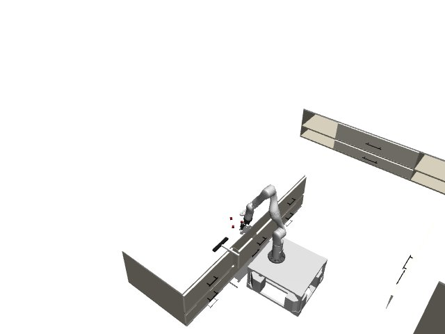

# Codex + GPT-6 Luna, effort medium — kinder-sweep-into-drawer-i00

Recorded 2026-09-28 before protocol v1.0 (Harbor job `kinder-full-sweep-into-drawer-codex-gpt6luna-medium-60min`, trial `kinder-sweep-into-drawer-i00__3WkCeTQ`). Not an official v1.0 result: the run went through the repository's former OpenRouter adapter (`harbor_agents/`, removed under PROTOCOL D11), and on the task as it then was.

| | |
|---|---|
| result | **0** |
| mode | privileged |
| task version | before protocol v1.0, which changed only this task's metadata and image name: the instruction it was given is an earlier wording of today's; the scene and verifier are the same. |
| agent | Codex 0.158.0 via OpenRouter, `openai/gpt-6-luna`, reasoning effort medium, web search off |
| budget | 60 min; tokens 100M in / 10M out (PROTOCOL D10) |
| agent time | 3602 s |
| tokens in / out | 16,919,351 / 227,232 (within the budget) |
| cost | $0.35 |
| verifier | `{"success": 0, "all_success": 0, "deterministic": 1, "n_actions": 949, "sim_steps": 949, "missing_trajectory": 0, "invalid_trajectory": 0, "grader_error": 0, "video_rendered": 1}` |

## What happened

goal region read from source; caught the drawer pull at 41.8 min, opened it ~7 cm; gripper-pad sweeps moved cubes a few cm; 949 steps, no success
