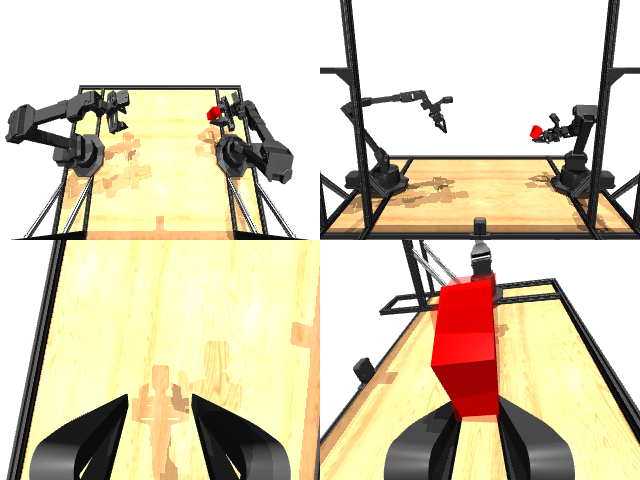

# Codex + GPT-6 Luna, reasoning effort xhigh, reasoning summaries on, 60 min — mujoco_playground_aloha_hand_over

Run: Harbor job `mj-gpt6luna-xhigh`, trial `mujoco_playground_aloha_hand_ove__C6yiMhN`, 2026-09-28. Mode: **unlimited**.

| | |
|---|---|
| result | **1 (success)** |
| agent time | 766 s |
| actions / physics steps | 1145 / — |
| tokens in / out | 1428659 / 39217 |
| verifier | `{"success": 1, "live_check_success": 1, "deterministic": 1, "box_to_target_m": 0.0047, "right_holds": 1, "left_touches": 0, "box_z": 0.2609, "time_s": 22.9, "n_actions": 1145, "video_rendered": 0, "grader_error": 0, "agent_resets": 41, "agent_cost_self_reported": 1}` |
| verifier sandbox | separate |

Debugging footprint (self-reported by the agent's tooling log): 18 sessions, 41 resets, None physics steps.

## Replay (verifier's six-camera video)

[replay.mp4](replay.mp4) — top: world / observer / head; bottom: front / left wrist / right wrist.

## Agent's last messages

- I caught a flaw in my exploratory IK loop: it was leaving the simulated arm at the solver’s temporary pose before each physics step. I’m moving IK calculations to a separate MuJoCo data buffer so every test and the final recording reflect actuator targets alone.
- The handover completed: the right gripper closed on the box, the left arm withdrew, and the final replay passed the success check. I’m checking the two deliverables and trajectory shape now.
- Completed and replayed successfully.  - [trajectory.npz](/app/output/trajectory.npz): shape `(1145, 14)`, seed `60417` - [gen.py](/app/output/gen.py): controller and recording script  Replay passed: box is `4.7 mm` from the target, held by the right gripper, with no left arm contact; final height is `0.2609 m`.
