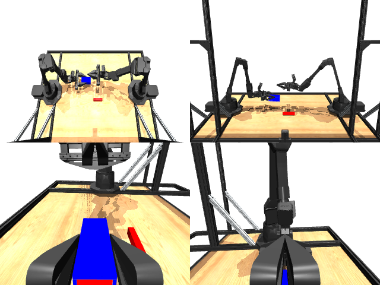

# Codex + GPT-6 Luna, reasoning effort xhigh, reasoning summaries on, 60 min — mujoco_playground_aloha_single_peg_insertion

Run: Harbor job `mj-gpt6luna-xhigh`, trial `mujoco_playground_aloha_single_p__WAgjxHD`, 2026-09-29. Mode: **unlimited**.

| | |
|---|---|
| result | **0** |
| agent time | 3600 s |
| actions / physics steps | 995 / — |
| tokens in / out | 7499064 / 182554 |
| verifier | `{"success": 0, "live_check_success": 0, "deterministic": 1, "inserted": 0, "tip_to_axis_m": 0.14928, "axial_t": 1.6873, "socket_z": 0.0923, "peg_z": 0.0108, "time_s": 19.9, "n_actions": 995, "video_rendered": 1, "grader_error": 0, "agent_resets": 145, "agent_cost_self_reported": 1, "agent_traces": 104, "agent_trace_videos": 1, "agent_trace_videos_skipped_budget": 1}` |
| verifier sandbox | separate |

Debugging footprint (self-reported by the agent's tooling log): 70 sessions, 145 resets, None physics steps.

## Replay (verifier's six-camera video)

[replay.mp4](replay.mp4) — top: world / observer / head; bottom: front / left wrist / right wrist.

## Agent's last messages

- I confirmed the left arm can lift the socket, but neither arm has a stable side grasp on the small peg from the frozen table pose. I’m testing contact strategies that can raise the peg’s tip enough to enter the socket while preserving the required final geometry.
- The peg’s tip can be brought close enough to the socket axis by pressing it against the table, but a long push makes it drop before it enters. I’m checking whether the socket can be set down in a stable pose so the final alignment can happen in a shorter, controlled sequence.
- I’m continuing from the latest placement and pusher experiments. I’ll tune the final contact sequence against the frozen replay, then save the verified actions and the generator script.
