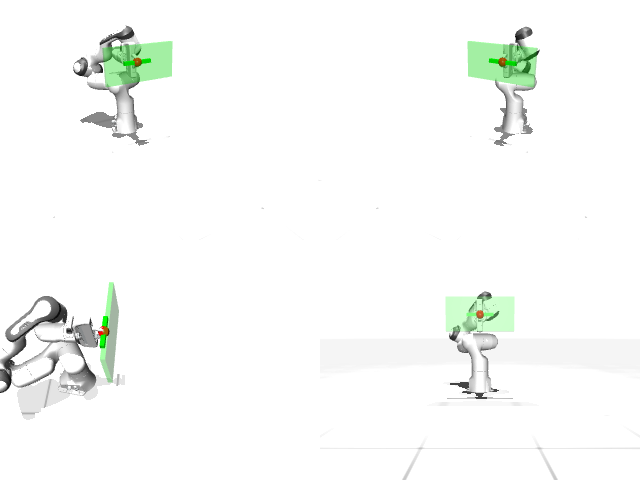

# Codex + GPT-6 Luna, reasoning effort xhigh, reasoning summaries on, 60 min — mujoco_playground_panda_open_cabinet

Run: Harbor job `mj-gpt6luna-xhigh`, trial `mujoco_playground_panda_open_cab__3YkprY7`, 2026-09-29. Mode: **unlimited**.

| | |
|---|---|
| result | **1 (success)** |
| agent time | 897 s |
| actions / physics steps | 1335 / — |
| tokens in / out | 1318444 / 41564 |
| verifier | `{"success": 1, "live_check_success": 1, "deterministic": 1, "handle_x": 0.2023, "handle_to_target_m": 0.0017, "time_s": 26.7, "n_actions": 1335, "video_rendered": 1, "grader_error": 0, "agent_resets": 23, "agent_cost_self_reported": 1, "agent_traces": 6, "agent_trace_videos": 6}` |
| verifier sandbox | separate |

Debugging footprint (self-reported by the agent's tooling log): 18 sessions, 23 resets, None physics steps.

## Replay (verifier's six-camera video)

[replay.mp4](replay.mp4) — top: world / observer / head; bottom: front / left wrist / right wrist.

## Agent's last messages

- The probe reached the target range while the closed fingers maintained contact, and the handle followed the gripper’s x motion. I’m recording the full approach, grasp, and pull now, with a short correction phase and a fresh replay check.
- The recorded trajectory now replays successfully: the handle ends at x = 0.2023 m, 1.7 mm from the target. I’m cleaning out the temporary probe files and checking that the two requested deliverables are the only files left in `/app/output`.
- Saved the requested files:  - [trajectory.npz](/app/output/trajectory.npz) — shape `(1335, 8)` - [gen.py](/app/output/gen.py) — trajectory generator  Fresh replay succeeded: the handle finished at x = 0.2023 m, **1.7 mm from the target**.
