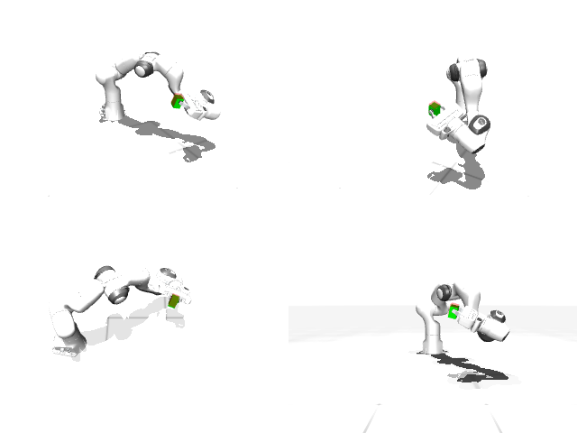

# Codex + GPT-6 Luna, reasoning effort xhigh, reasoning summaries on, 60 min — mujoco_playground_panda_pick_cube_orientation

Run: Harbor job `mj-gpt6luna-xhigh`, trial `mujoco_playground_panda_pick_cub__V7VoKZT`, 2026-09-29. Mode: **unlimited**.

| | |
|---|---|
| result | **1 (success)** |
| agent time | 1479 s |
| actions / physics steps | 2425 / — |
| tokens in / out | 4721341 / 71549 |
| verifier | `{"success": 1, "live_check_success": 1, "deterministic": 1, "box_to_target_m": 0.0091, "rot_err_deg": 2.69, "box_z": 0.3311, "time_s": 48.5, "n_actions": 2425, "video_rendered": 0, "grader_error": 0, "agent_resets": 96, "agent_cost_self_reported": 1}` |
| verifier sandbox | separate |

Debugging footprint (self-reported by the agent's tooling log): 30 sessions, 96 resets, None physics steps.

## Replay (verifier's six-camera video)

[replay.mp4](replay.mp4) — top: world / observer / head; bottom: front / left wrist / right wrist.

## Agent's last messages

- The first grasp missed because the fingers pushed the cube sideways during closure. I found a persistent wrist-position offset of roughly 8 mm at the pickup pose, so I’m compensating for it and aligning the pinch with the cube’s edges before retrying the lift.
- The object-space controller now keeps the cube in the fingers through transport and rotation; replay reaches the target orientation with under 3° error. Its center is 17 mm below the target, close to the 20 mm limit, so I’m raising the commanded final center slightly to leave more position margin.
- Generated [trajectory.npz](/app/output/trajectory.npz) with 2,425 control steps and saved its generator at [gen.py](/app/output/gen.py).  Replay succeeded: the cube ended 9.1 mm from the target center with 2.69° orientation error.
