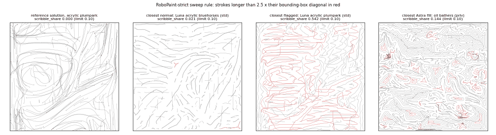

# RoboPaint

Brush art on ManiSkill 3.0.1 (SAPIEN 3.0.3, PhysX on the CPU): a Panda holding a brush or pen copies a picture onto a paper
sheet, dipping in an ink stone or paint wells, with a practice sheet beside it. `simulator = "maniskill"`,
`robot = "franka-panda"`. Six families, 43 targets (Targets): 楷书 kaishu (2 works), 行书 xingshu (8 characters and works),
草书 caoshu (6: 2 characters and 4 works), lettering (6: 臨摹 of engraved English round hand with a pointed pen, 2 flourished
words and 4 copy lines: Lettering), acrylic (10) and oil (11) paintings. Each target is a privileged task
`robopaint-<family>-<target>-i<NN>-privileged` and its standard twin `...-i<NN>-standard` on the same frozen instance (`i00`;
the oil paintings `i01`, Targets); `[metadata].family = "robopaint_<family>_<target>"`. The line family (9 line drawings) is excluded from the benchmark and
not in this repository: its tooling serves only rcb-limited/2.0.

## Quick start
```bash
harbor run -d embodied-first-exam@all -p tasks/robopaint -a codex -m openai/gpt-6-astra
```
Every image is public: Harbor pulls it.

Every task has **process rules** on top of the picture rule: the exemplar has to be written or painted with strokes, the way a
person does, not coloured in (Process rules).

## Targets
- 楷书 kaishu: two works, 永字八法 (21 strokes) and 麟鳳龜龍 (71).
- 行书 xingshu: eight, 永, 和, 風, 年, 山, 賢 and the works 惠風和暢 and 茂林脩竹.
- 草书 caoshu: two characters and four works (Caoshu).
- Lettering: six copies of engraved English round hand (Lettering).
- Oil: eleven paintings with a pointed brush (Oil: the pointed brush), `robopaint-oil-<painting>-i01`.
- Acrylic: ten paintings.

**麟鳳龜龍** (the four auspicious creatures of the 禮記) is the densest work: 71 strokes, an exemplar of 8036 mm², strokes
about 4.2 mm wide (the exemplar's area per stroke length), and 麟 alone has 23 strokes. Like the other kaishu targets it comes from Make Me a Hanzi's `graphics.txt` @ bddc96d
(Arphic Public License); its reference writer uses the diagonal entry.

**The reference writer's entry.** The default writer stops above each stroke's start, presses straight down
and lifts straight up. At the stop the arm rebounds a fraction of a millimetre, and the brush takes the rebound as its
direction of travel (in the air θ follows any motion faster than 1 cm/s): on about a quarter of the strokes the drag tail
meets the paper turned against the stroke and sweeps a disc. Dense works have many short, thin strokes, where these discs
fall outside the exemplar and fail the stray-ink limit. With the diagonal entry the brush enters and leaves the paper on
straight 8 mm lines along the stroke, without a stop, in the robot-free optimisation and on the robot alike. The default is
the vertical touch-down.

**The reference solutions.** A copy should look like its exemplar, "like a print". All ten kaishu and xingshu pairs have
references from the calligraphy planner's "print" profile, made at generation time on the graders' copy of the instance
(whose `truth` holds the exemplar's ink; the agent's copy does not):
- a robot-free trajectory optimisation against the task's brush model, one brush contact at a time (kaishu: an exemplar
  stroke; xingshu: a contact of the connected-stroke plan): control points (x, y, press) about every 6 mm along the contact's
  centre path, initialised by inverting the brush's trailing dynamics, fitted by least squares on the rendered contact against
  its ink (a 512 px grid; the other contacts' ink does not count; ink more than 1 mm from the exemplar weighted 1.5x);
  deterministic (one BLAS thread);
- the brush enters the paper along the stroke and leaves it back onto its own root (回锋), with a press of at least 0.6 mm
  inside a contact, so no disc is swept at a start, no needle is drawn at an end, and no contact splits in two;
- per contact, three centre paths are tried and the lowest residual is kept: the regions' medians; a walk over each region's
  skeleton that covers every branch (rings round, side branches out and back), so a region whose given centre line covers
  only part of it is written in full; and the medians with out-and-back excursions into lobes they leave uncovered;
- two more rounds for the contacts holding a region covered under 0.92, with missing and stray ink weighted 3x;
- on the robot: a dip before every contact, travel, the entry line, the contact at 2 cm/s and the return exit; each control
  step commands the inverse kinematics of the desired tip 0.125 s ahead (feed-forward for the arm's PD lag), and passes of
  iterative learning control correct the commanded path by the realized tip error. The robot step runs with 3 and 5 passes
  and keeps the result with the larger worst margin against IoU 0.92, boundary F 0.90, every region 0.90 and stray 0.01;
  the final pass is recorded as `solution/oracle_qpos.npy`, which `solution/solve.sh` replays (`solution/oracle_paint.py`).

The process limits are set from the first references' `path_mm` and mark width. The references' verifier metrics:

| target | IoU | boundary F | min stroke coverage | stray | `path_mm` | `mark_width_mm` |
|---|---|---|---|---|---|---|
| kaishu 永字八法 | 0.940 | 0.988 | 0.931 | 0.0015 | 1270 | 3.71 |
| kaishu 麟鳳龜龍 | 0.908 | 0.976 | 0.890 | 0.0040 | 2828 | 3.07 |
| xingshu 永 | 0.942 | 0.941 | 0.913 | 0.0049 | 726 | 5.14 |
| xingshu 和 | 0.957 | 0.958 | 0.957 | 0.0007 | 927 | 4.56 |
| xingshu 風 | 0.938 | 0.931 | 0.948 | 0.0056 | 1181 | 5.00 |
| xingshu 年 | 0.957 | 0.963 | 0.933 | 0.0021 | 1013 | 4.59 |
| xingshu 山 | 0.970 | 0.966 | 0.973 | 0.0021 | 608 | 6.75 |
| xingshu 賢 | 0.934 | 0.938 | 0.944 | 0.0054 | 1234 | 4.59 |
| xingshu 惠風和暢 | 0.917 | 0.969 | 0.926 | 0.0026 | 2483 | 3.04 |
| xingshu 茂林脩竹 | 0.898 | 0.962 | 0.910 | 0.0054 | 1412 | 2.79 |

What still limits the copy:
- **Spikes behind blunt starts.** The brush's mark is a flat end at the root with a parabolic drag tail behind it, and the
  root trails the handle. While the press grows after a start, the tail reaches 2–5 mm behind the start point, where the
  exemplar has a blunt end.
- **Robot tracking.** The robot's result is 0.005–0.015 IoU below the robot-free plan.
- **Dense works.** 麟鳳龜龍, 茂林脩竹 and 惠風和暢 lose most in the 1 mm band around their thin strokes.

## Tasks
- The task directories are the deliverable; the tooling that built them is kept outside this repository.
- The standard twin's client and service layer come from `embodied_first_exam/standard/`.
- The process rules are in every copy of the instance's `target.success`; `rcb_brush_strict.py` is on the graders' side
  (wired in by `tests/grade.py`, `tests/Dockerfile` and `environment/docker-compose.yaml`); the rule texts are in
  `instruction.md` (after "Target and score"), `README.md` and the `task.toml` description. "strict" survives in internal
  names only: `rcb_brush_strict.py`, `RCB_TOOL_MODULE=rcb_brush_strict` and the `reward.json` key `strict_ok` (the process
  rules).
- The oil rule is calibrated on the reference solution's own execution (the thresholds per painting: Oil: the pointed
  brush), and the oil texts state them.
- Every task follows `normalize()` of `scripts/task_conventions.py` (the repository's conventions; `--check`
  passes on every RoboPaint task).
- Benchmark-specific metadata: `difficulty`, `medium`, `stroke_count`, `structure`, `characters` (TAXONOMY).
- Every pair has a real reference solution in `solution/`.
  - The privileged `solution/solve.sh` replays the frozen reference plan.
  - The standard one streams the same joint targets through the client; it waits out a service restart and continues
    from the control step the service reports.
  - The oracle label is `partial` on all 86 tasks (see Oracle evidence).
- CI:
  - `python3 scripts/files_image.py check robopaint-files`: `embodied_first_exam/benchmarks/robopaint/` still hashes to
    `images/robopaint-files/FILES.json` (the pinned files-only image);
  - `ci_checks/benchmarks/robopaint/advisory-tooling.sh` keeps every copy of the shared files left in task dirs (the sidecars'),
    `rcb_brush_strict.py` included, byte-identical to `embodied_first_exam/benchmarks/robopaint/`, within a family and across the families;
  - `ci_checks/benchmarks/robopaint/invariant-leak.sh` (PROTOCOL Appendix H.2) admits the rule keys in the agent's copy of the
    instance, and in the agent's Dockerfile a `COPY --from` only of the pinned files-only image and only for an allowed
    agent-side file (`rcb_brush.py`: its source must hash to FILES.json and, like a task dir's copy, carry no grader code).

## Oracle evidence
A task is labelled `oracle = "full"` only if a recorded oracle run scored 1 on byte-identical grader, frozen instance,
tooling and oracle code; every RoboPaint task is `partial`. Its `oracle_evidence` points to the
runs in Validation: the pairs with their own evidence to Harbor `-a oracle` (1) and `-a nop` (0) runs in both modes on
their current files, the others to the release validation and the process-rule validation. Human review in PR #3.

## Validation
- **Release validation** (the picture-rule version, each family at its release commit): Harbor's oracle scored 1 and nop 0
  on every target in both modes (kaishu 70, xingshu 32, lettering 20 (earlier words), acrylic 20, oil 22). Changed since,
  in every pair: the registered scoring (the success rule in `instance.json`, `rcb_brush_score.py`; the saved oracle
  trajectories re-scored all pass, and Harbor oracle + nop re-checked two pairs per family), the scorer's tooling snapshot
  (re-scores bit-identical), the 2.2 inputs and rated limits in `rcb_brush.py` (tooling queries only), and the standard
  twins' service, collect hook, grader and client.
- **Process rules**, on the built task images (`ghcr.io/mll-lab-nu/efe:robopaint-0.2.0`, each task's verifier image run as Harbor runs it):
  every pair's reference trajectory succeeds in the privileged verifier and through the standard path (82 of 82); Harbor
  oracle 1 and nop 0 on both modes of one pair per family. Re-graded recorded runs of the picture-rule version: the process
  rules turn 102 of GPT-6 Astra's 109 picture-rule successes (colouring in) and 4 of GPT-6 Luna's 53 (Calibration) into
  failures and no failure into a success; the picture verdict is unchanged in all 360 runs.
- **Pairs with their own evidence** (the ten calligraphy pairs with re-made references, kaishu
  linfengguilong among them): Harbor `-a oracle` 1 and `-a nop` 0 in both modes on their current files; re-solving each
  (robot step and self-test) passes and gives the same reference trajectory bit for bit.

## Caoshu (草书)
Cursive writes a character in a few long brush contacts: the contact cap is the exemplar's own connected contacts (1.6–3 per
character, against 6 in xingshu and 8 in kaishu, medians), each contact runs through turns, loops and crossings, and hairline
ligatures (牵丝) join strokes and characters. Six targets: `wen` 文 and `zhen` 真 (characters), and four works, each one column of
the scroll as written, its characters sharing one 210 mm frame so the ligatures between them stay on the sheet: `nangong` 南宮,
`siwushaonian` 四五少年, `zhongtiangechuifen` 中天哥吹分 and `beiquelindanshui` 北闕臨丹水.
- Exemplars: 張旭《古詩四帖》, Wikimedia Commons File:張旭 古詩四帖.jpg ({{PD-old-70}}). The scan is thresholded (Otsu, with a
  hysteresis that keeps faint ligatures). Whole ink components are kept: the selection box only picks them, a ligature into a
  neighbouring character is cut explicitly (`cut`) and a stroke of the neighbouring column is excluded explicitly (`exclude`). A
  dashed hairline that the threshold breaks up is bridged along its own trace (`bridge_lines`), a dry stroke (飛白) is closed
  within its own area only (`close_regions`), and the edge is smoothed on the signed distance with hairlines kept at their width.
  The skeleton graph is split into trails by good continuation at junctions (one trail = one brush contact of the cap),
  and every trail is cut into regions of at most 30 mm of centre path, so the region coverage holds along a long stroke and on
  its hairlines.
- Reference solution: one plan per contact (the calligraphy optimiser over the contact's regions, control points every
  4 mm, 3 mm where refined), with a press floor of 0.4 mm (a contact that touches at zero press breaks into two on the
  robot) and, in the works, at most 1 mm of press at the touch-down and the lift (the arm sways there and a deeper press
  leaves a blot); nangong's longest contact keeps its control points within 6 mm of their start (with a press floor the
  optimiser otherwise parked surplus path off the sheet, outside the residual's window).
  The robot execution is the kaishu one (three ILC passes, more made the tracking worse). Scoring, thresholds and process rules are those of kaishu
  and xingshu.
- Robot-free checks of the rule on the reference plans: one press for the whole sheet, a lift at every region
  boundary or in the middle of every contact, a missing contact, presses ×0.8 or ×1.2 and the naive plan fail on all six; one
  press per contact fails on five (文 passes with IoU 0.83 and a worst region of 0.81); every contact moved ±0.5 mm relative to
  the others fails on the four works, ±1.5 mm on all six.
- The references (the oracle scores 1 and nop 0 in both modes on all six):

  | pair | contacts (cap) | regions | IoU | boundary F | min region | stray | `path_mm` / `max_path_mm` | `mark_width_mm` / min |
  |---|---|---|---|---|---|---|---|---|
  | wen 文 | 2 | 9 | 0.913 | 0.958 | 0.921 | 0.005 | 269 / 810 | 4.57 / 1.37 |
  | zhen 真 | 3 | 12 | 0.941 | 0.955 | 0.894 | 0.003 | 534 / 1610 | 5.86 / 1.75 |
  | nangong 南宮 | 5 | 24 | 0.918 | 0.984 | 0.897 | 0.003 | 890 / 2680 | 3.11 / 0.93 |
  | siwushaonian 四五少年 | 8 | 20 | 0.894 | 0.978 | 0.856 | 0.002 | 641 / 1930 | 2.66 / 0.79 |
  | zhongtiangechuifen 中天哥吹分 | 8 | 17 | 0.826 | 0.979 | 0.859 | 0.006 | 525 / 1580 | 1.91 / 0.57 |
  | beiquelindanshui 北闕臨丹水 | 12 | 27 | 0.844 | 0.972 | 0.849 | 0.005 | 891 / 2680 | 1.98 / 0.59 |

## Lettering: 臨摹 of engraved English round hand
The family copies public-domain engraved copybook plates with the pointed pen: George Bickham, *The Universal Penman* (London,
1741), in the Getty Research Institute's scan on the Internet Archive (`gri_33125008538056`, NOT_IN_COPYRIGHT; the same book is on
Wikimedia Commons under {{PD-scan}}). Six targets, each placed 205 mm wide
on the sheet: two flourished headings with all their flourishes, `liberty` ("Liberty.", G. Brooks) and `virtue` ("Virtue.", plate
12), and four copy lines of the plate COPIES (W. Clark): `aim` ("Aim at improvement in every line."), `business` ("Business makes
a Man respected."), `commendation` ("Commendation animates the mind.") and `diligence` ("Diligence in youth is commendable.").
- **The exemplar**:
  the scan's ink (darkness against the local paper level, upsampled x4, Otsu with a hysteresis; short faint gaps of a hairline
  bridged where the scan still has ink), its centre paths and thickness, re-drawn with the task's own pointed pen: one spread axis
  for the whole exemplar (the normal of the shades' mean direction, -33° to -38°) and at every point the tines' spread that gives the
  scan's thickness there; dots and ball terminals become pressed dashes across the axis, as wide as the ball. `target.png` is that
  rendering (`LetterTarget`, unchanged), so every mark of the picture is one the pen can make; against the scan's ink on the sheet
  raster its IoU is 0.86-0.88 (the pen's hairline is 0.4 mm, the engraving's about 0.2-0.3 mm), 99.8-100 % of the scan's ink lies
  within 0.5 mm of the target and all of the target within 0.5 mm of the scan's ink. One known shortfall: the heaviest shade of
  `virtue`'s right swash runs too far from square to the spread axis, so the tines at their full 2.0 mm draw it a little thinner
  than the engraving. QA: the target's outline on the scan, checked for every target.
- **Regions** (the strokes of the scorer's per-stroke coverage): the centre paths joined into trails by good continuation through
  the crossings, each cut into equal pieces of at most 30 mm, so every part of a long flourish counts.
- **The cap** = one contact per connected piece of the exemplar's ink (its own pen lifts, no margin): a whole word, a capital with
  its flourishes, an i's dot. A contact's route runs once over every part of its piece and twice where it has to go back.
- **Rule**: IoU ≥ 0.85, boundary F ≥ 0.80, every region covered ≥ 0.75, stray ≤ 0.04, the cap, the 5 mm registration (the
  family's rule; a lower region coverage, 0.70, would let one constant press per contact pass `commendation`), plus the
  process rules.
- **Reference solution**: one planned route per contact, written with the pen at the spread axis, the press
  from the spread, 5 mm/s (slower at sharp turns), lag feed-forward and eight passes of iterative learning control; the recorded
  pass is the best one (every contact one stroke, the smallest tracking error).
- **Rule study** (robot-free: the plan drawn with the pen's ideal mark and scored by the unchanged scorer), all six
  targets: the reference plan passes; one constant press (per contact or overall), hairlines only, full press, the spread axis
  turned 90°, contacts shifted alternately by ±0.5 mm, one lift more, one contact skipped, one stroke per region and the shades
  filled with hairline passes all fail. The spread axis turned 30° fails the two words but passes the four lines (their shades are
  short); the press scaled by 0.8 or 1.2 passes all (a lighter or heavier hand).
- **Reference solutions** (the verifier, two fresh replays, deterministic; stray 0 and every contact one stroke on all six):

  | target | cap (strokes) | regions | IoU | worst region | control steps | `path_mm` (longest contact) |
  |---|---|---|---|---|---|---|
  | liberty | 5 | 82 | 0.964 | 0.939 | 13282 | 2644 (1845) |
  | virtue | 4 | 64 | 0.959 | 0.942 | 11633 | 2288 (1833) |
  | aim | 11 | 54 | 0.956 | 0.941 | 7574 | 998 (400) |
  | business | 9 | 54 | 0.955 | 0.955 | 9661 | 1240 (312) |
  | commendation | 9 | 52 | 0.957 | 0.933 | 8262 | 1079 (431) |
  | diligence | 11 | 59 | 0.959 | 0.923 | 10262 | 1343 (459) |
- Harbor: the oracle scores 1 and nop 0 in both modes on all six.

## Image and host
- `images/robopaint/` holds ManiSkill 3.0.1, SAPIEN 3.0.3, a patched libmypaint 1.6.1 and Spline-FRIDA.
  - The image is `ghcr.io/mll-lab-nu/efe:robopaint-<images/robopaint/VERSION>` (0.2.0), public.
  - It is built from the repository root: `docker build -f images/robopaint/Dockerfile .`.
- `images/robopaint-files/` is the files-only image of the shared tooling and graders,
  `ghcr.io/mll-lab-nu/efe:robopaint-files-<VERSION>@<digest>` (`FILES.json`), public like the base image: `FROM scratch` with
  the files of `embodied_first_exam/benchmarks/robopaint/` (checkout modes, content-derived mtimes). A change to one of them needs a new
  version: bump `VERSION`, `python3 scripts/files_image.py build robopaint-files`, push, `python3 scripts/files_image.py pin
  robopaint-files <digest>`, then the tasks' `COPY --from` lines name the new digest.
- `images/robopaint-pictures-files/` is the files-only image of the 43 exemplar pictures,
  `ghcr.io/mll-lab-nu/efe:robopaint-pictures-files-<VERSION>@<digest>`, public: `/<task without mode>/target.png`. The pictures
  are not in git; they are in the public Hugging Face dataset `MLL-Lab/embodied-first-exam-public` (folder `robopaint/`, each
  with its licence notice), pinned by commit and sha256 in its `FILES.json` (`python3 scripts/files_image.py fetch
  robopaint-pictures-files`, no login). The agent image (`/app/target.png`) and the privileged verifier (`/tests/target.png`)
  take the task's picture with `COPY --from`, and so do the sidecars (built from `environment/sim/` or
  `environment/scorer/`, their `Dockerfile`: the picture at `/srv/target.png`).
- Every simulator container needs an NVIDIA GPU: SAPIEN needs a Vulkan device to build the scene and to render. Physics
  and the brush models run on the CPU.
- A standard twin's agent container and verifier use the one client base of every standard task
  (`embodied_first_exam/standard/client.env`, pinned by digest). The agent side installs the exact pins of
  `client-requirements.txt`, inline (`ci_checks/check-standard-client.sh`).
- Agent egress is an allowlist (the model APIs and the package registries) on every task, because the sources of some targets are public.
- Frozen inputs over 2 MB: 9 of the 11 oil reference pictures (`target.png`, 2.0–2.5 MB; per pair, the two sidecar copies in the task
  directories and the pictures image's one for the agent and verifier images).
  - They are photographic scans, so lossless re-encoding gets only 5 of the 9 under 2 MB.
  - They stay as frozen (the instance hash covers their pixels). The 2 MB limit is for results.

## Time budget
3600 s for every task of both modes: each task's own `[agent] timeout_sec` (PROTOCOL §2,
docs/protocol/running.md "The agent's time"); `instruction.md` states it once, in its closing `## Time limit` section, and the
rest of the text says "the time limit (`## Time limit`)". What the agent has to fit into it:
- learning the brush's mark from test strokes on the practice sheet: width against press depth, the drag of the tuft, the
  paint's blending (the privileged mode gives the exact sheet but no brush model);
- every stroke on the main sheet is irreversible in standard mode;
- works and paintings take tens to thousands of strokes (stroke caps up to 71 for a calligraphy work and 2546 for an oil
  painting), each at the arm's real speed.

## The target is only a picture
`target.png` (RGB) in both modes. Its source (glyph outlines, pen paths, the exemplar's paint coverage) stays in the
graders' copy of the instance. Nothing derived from it is in the agent's container (`ci_checks/benchmarks/robopaint/invariant-leak.sh` (PROTOCOL Appendix H.2)).

## Scoring
Success needs the picture rule and the process rules; `final_reward` is the continuous score.
- The picture rule: every quantity is taken after the best global shift of the sheet within 5 mm. Success needs every threshold.
  - Calligraphy and lettering: IoU of the inked areas, boundary F, per-stroke (lettering: per-region) coverage, stray ink and a
    stroke cap.
  - Paintings: blurred CIELAB ΔE, SSIM of L*, edge correlation and paint coverage.
- The process rules (below) are measured on the strokes themselves.
- Privileged mode: `s.score()` asks a `scorer` sidecar (the graders' copy), so the agent may check itself.
- Standard mode: the agent gets no score at all. When the episode is over, the sim service scores its live main sheet with the
  graders' scorer and rules; that is the verdict (Grading and determinism).

## Why process rules
Scored only against the picture, a sheet passes when the exemplar's area is filled without writing or painting: one light
press that draws a thin line, kept for the whole episode, along long back-and-forth or contour-offset paths (colouring in),
or serpentine fills of a painting. The rules measure the strokes themselves. They are placed so that colouring in fails
while ordinary attempts, good or poor, keep their picture verdict (Calibration).

## Process rules
Only inked (painted) strokes on the main sheet count; practice-sheet strokes are free. `path_mm` = the total length of the brush
(pen) tip's path while it presses on the main sheet, summed over the 100 Hz physics samples.

| Families | Rule (each task states its own numbers) |
|---|---|
| kaishu, xingshu, caoshu, lettering | **Colouring in fails:** `path_mm` > `max_path_mm` (3 × the reference solution's `path_mm`, rounded up to 10 mm) **and** `mark_width_mm` < `min_mark_width_mm` (0.3 × the reference's, rounded down to 0.01 mm). `mark_width_mm` = the area each stroke inks on its own (its own mark, coverage ≥ 0.5; overlaps between different strokes count again), summed over the strokes, / `path_mm`: the marks' average width. |
| kaishu, xingshu, caoshu | **Strokes are counted as written:** the stroke cap counts the marked pieces of the contacts: a contact is cut where the brush moves more than `stroke_gap_mm` (5 mm) along the main sheet without marking it (its mark narrower than `mark_min_width_mm`, 0.1 mm), and a piece longer than `max_stroke_path_mm` (5 × the reference solution's longest piece, rounded up to 10 mm) counts as ⌈length / `max_stroke_path_mm`⌉ strokes; `n_strokes_counted` ≤ `max_strokes`. **Strokes are sweeps** (the paintings' rule on these pieces): `scribble_share` ≤ 0.10 with the ratio 12 (Counted strokes in calligraphy). |
| acrylic, oil | **Path budget:** `path_mm` ≤ `max_path_mm` (3 × the reference's, rounded up to 100 mm). **Strokes are sweeps:** `scribble_share` ≤ 0.10, the share of `path_mm` in strokes longer than 2.5 × the diagonal of their bounding box (taken as at least 10 mm): zigzags, back-and-forth fills, spirals, loops (a sweep out and back along one line is about 2). |

The numbers per task: `max_path_mm` 3230–7880 mm (kaishu), 1200–6060 mm (xingshu), 810–2680 mm (caoshu), 3000–7940 mm
(lettering), 32300–51700 mm (acrylic), 51400–86500 mm (oil); `min_mark_width_mm` 0.99–1.34 mm (kaishu), 1.12–3.06 mm (xingshu),
0.57–1.75 mm (caoshu), 0.10–0.13 mm (lettering: below the pointed pen's 0.4 mm hairline, so for the pointed pen the colouring-in
rule never fires; Lettering).

`success` = the picture rule (`image_success`) ∧ the process rules (`strict_ok`). `final_reward` = the picture rule's
continuous score × min(1, `max_path_mm` / `path_mm`) when colouring in or over the path budget, × (1 − `scribble_share`) when the
sweep rule fails: rule-abiding work keeps the picture rule's score. `reward.json` reports `image_success`, `image_final_reward`,
`strict_ok`, `path_mm`, `max_path_mm`, `mark_width_mm`, `min_mark_width_mm`, `colour_in`, `path_budget_ok`, `scribble_share`,
`scribble_max`, `scribble_ok` and `longest_stroke_mm` next to the picture rule's metrics; the privileged `s.score()` returns them too,
and `s.strokes()` holds each stroke's samples and own mark, so an agent can check itself. The instructions state the rules in plain
words (write or paint with strokes the way a person does; colouring in, filling, zigzag, serpentine and contour-offset fills fail)
and with the task's numbers.

Where they are applied: `rcb_brush_strict.py` (graders' side only), a `Session` subclass whose `score()` adds the rules, run with
`rcb_brush.py`'s CLI. The privileged verifier replays with it (`/tests/grade.py`), the privileged scoring service imports it
(`RCB_TOOL_MODULE=rcb_brush_strict`), and the standard sim service scores the live sheet with it (`RCB_TOOL=/srv/rcb_brush_strict.py`).
The agent's container holds `rcb_brush.py` only.

## Calibration
The thresholds were set on replays of recorded trajectories (reference solutions, GPT-6 Astra and GPT-6 Luna runs, 360 in
all, on the pairs of that time) scored with and without the process rules; every trial near a threshold was inspected
as a path picture.

| Population | Runs | Picture rule only | With the process rules | Flagged by the rules |
|---|---|---|---|---|
| reference solutions | 82 | 82 | 82 | 0 |
| GPT-6 Astra | 112 | 109 | 7 (its real lettering) | 105, all colour-in |
| GPT-6 Luna, successes | 53 | 53 | 49 | 4: three acrylic serpentine fills, lettering moon (zigzag fill along the strokes) |
| GPT-6 Luna, failures | 195 | 0 | 0 | 22, all colour-in (2 comb fills in xingshu, 20 painting fills) |

Margins (a value / its task's limit):
- Writing, mark width:
  - the colour-in runs reach at most 0.97 (Astra lettering omnium std, a thin multi-pass fill); every other fill is ≤ 0.88;
  - the closest normal run is at 1.15, a Luna failure (xingshu xian, standard) that retraces heavily with a 5.0× path.
- Writing, path: the colour-in runs are at ≥ 1.10. Normal runs with thin marks (a light hand) stay ≤ 0.29.
- Writing, why not a path budget alone: ten normal Luna failures retrace or wander to 3.1–5.0× the reference's path, which overlaps
  the colour-in runs from 4.5×. The mark width separates them.
- Paintings:
  - normal runs: scribble share ≤ 0.021 and path ≤ 1.44× the reference (0.48 of the limit). The closest is a Luna failure
    (acrylic bluehorses, standard) that paints many strokes out and back along one line;
  - fills: scribble share ≥ 0.143 (Astra oil bathers, a wavy meander fill); every other fill is ≥ 0.37;
  - the reference solutions: 0 and 0.33 of the limit;
  - the closest flagged attempt is a Luna failure, acrylic plumpark (standard, 0.54): long meanders that cover whole areas
    with a wide brush. Counting it as a fill is defensible but borderline; the figure below shows it next to the reference
    solution, the closest normal attempt and the closest Astra fill;
  - why 2.5 and 0.10: at a ratio of 2 the out-and-back strokes count (that Luna failure: 0.66), at 2.2 there is no gap
    (0.148 normal against 0.244), and at 3 the Astra meander fill drops to 0.055.
- The sweep rule's boundary (strokes longer than 2.5 × their bounding-box diagonal in red):

  
- Raster rows: rows of straight strokes stay allowed in oil. The oil reference painter lays its underpainting that way, and Luna's
  four oil successes are such rows.
- Known limitation: the closest colour-in run (Astra lettering omnium, standard) sits at 0.97 of its mark-width limit, so a fill
  with a slightly wider nib could pass; the rule chooses leniency on purpose. Likewise the closest painting fill (Astra oil bathers)
  is only 1.43× the sweep limit.

## Counted strokes in calligraphy
A stroke cap that counts contacts, with the colouring-in rule as the only bound on what one contact does, leaves three
ways round:
- **Ink-free connectors.** The Wang brush leaves no mark below a press of about 0.25 mm (Width(z) = 1.187 z − 0.03 cm), but the
  contact stays open: separately written pieces joined at a press that makes no mark count as one contact.
- **Held contacts.** One contact kept on the paper to retrace and re-pose the arm.
- **Fills.** Serpentine and dot fills within the colouring-in numbers.

**The rule** (`rcb_brush_strict.py`; the numbers in every graders' copy of `target.success`, stated in each instruction; the
agent's own privileged copy of the instance holds no counting numbers):
- a contact's samples mark when the brush's mark is at least `mark_min_width_mm` = 0.1 mm wide (column 3 of the samples,
  `w`: less than half a 0.22 mm pixel, which never reaches the 0.5 ink coverage the score counts). Its marked pieces are the
  runs of marking samples, joined across non-marking samples unless the tip moves more than `stroke_gap_mm` = 5 mm there; the
  touch-down and the lift before the first and after the last marking sample belong to no piece;
- each piece counts as one stroke, or ⌈length / `max_stroke_path_mm`⌉ when it is longer than `max_stroke_path_mm` =
  5 × the reference's longest piece, rounded up to 10 mm:
  600–2240 mm; `strokes_counted_ok` = `n_strokes_counted` ≤ `max_strokes`;
- the paintings' sweep rule on the pieces: at most 10 % of the pieces' path in pieces longer than 12 × their bounding-box
  diagonal (at least 10 mm);
- `final_reward`'s cap scaling is taken on the counted strokes. The picture rule keeps its own contact count
  (`n_strokes`, `stroke_count_ok`).
- Lettering and the paintings carry none of these keys: their verdicts and `final_reward` are unchanged (checked on the 16
  lettering and acrylic references and on every recorded run below).

**Why these numbers.** On the 16 references, earlier references of the same pairs and 27 genuine model calligraphy
runs on the same instances, every contact is exactly one piece (the references' longest
non-marking stretch inside a contact is 2.9 mm, a light turn); the longest piece is at most 2.98 × the reference's (Luna's
privileged xingshu-nian success); the largest scribble ratio is 4.96 (references) and 9.95 (a Luna failure that retraces
heavily, xingshu-xian standard). Recorded colouring-in runs on these instances are each failed by a new rule too,
independently: counted strokes 7–690 against caps 6–21, or a scribble share of 0.69–1.0.

**Constructions.** Each pattern was built from the pair's reference solution in the base image and graded by the
graders' copy: connectors that re-write every contact, a contact gone over back and forth, and dot fills joined at a
0.2 mm press fail (counted strokes over the cap, a scribble share of about 0.75, or colouring in); consecutive contacts
joined at a 0.2 mm press with nothing written twice are not penalised.

**Not caught (accepted).** A contact may still go over its own stroke a few times: up to 5 × the reference's longest piece
it counts once (Luna's genuine 2.98 × retrace sets that margin), unless its back-and-forth makes it a scribble (ratio > 12).

## Oil: the pointed brush
- **The brush.** `tanda/oil-03-paint` at `radius_log_offset` 0.6, made pointed: libmypaint's `offset_by_random` and
  `tracking_noise` get a pressure input, so they grow with the pressure as the dab radius does (0 at no pressure, the
  preset's value from 40 % on). Without it the preset draws no solid mark narrower than about 5 mm (it scatters the dabs
  over the brush's base radius at any pressure). It is frozen as `brush.preset_json` and stays CC0.
  - Straight strokes at 40 mm/s are about 2 mm wide at a 1.25 mm press, 2.5 mm at 1.5 mm, 3 mm at 2 mm, 4.2 mm at 3 mm, 6 mm at
    4 mm, 8 mm at 5 mm and 11 mm from 6 mm on.
- **The reference solutions.** Each is a stroke program from the layered painter: a ground of
  rows at a 7 mm press, then 4 layers of curved strokes at 4, 2.5, 1.6 and 1.3 mm presses (marks of about 6, 3.6, 2.6 and 2.1 mm).
  - The robot executes it with the program's motion settings: a 6 mm hover between strokes, quick dips and short holds.
  - 1316–1697 strokes and 49.7k–62.0k control steps: 41–52 of the episode's 60 simulated minutes (the 72000-step guard).
- **The rule.** It is calibrated on that execution, with an SSIM margin of 0.04 (with 0.03 the reference
  painted 50 % faster misses on Pearl Earring; with 0.04 no coarse painting passes). The stroke cap is 1.5 × and the path
  budget 3 × the reference.

| Painting | Reference strokes | Reference ΔE / SSIM | Rule ΔE / p90 / SSIM / edge |
|---|---|---|---|
| wanderer | 1333 | 2.73 / 0.913 | 3.1 / 5.5 / 0.87 / 0.78 |
| temeraire | 1580 | 3.49 / 0.894 | 3.9 / 6.5 / 0.85 / 0.59 |
| pearlearring | 1638 | 3.98 / 0.884 | 4.4 / 8.5 / 0.84 / 0.76 |
| milkmaid | 1677 | 4.53 / 0.852 | 5.0 / 9.5 / 0.81 / 0.74 |
| monalisa | 1686 | 4.70 / 0.863 | 5.2 / 8.5 / 0.82 / 0.70 |
| bathers | 1673 | 4.92 / 0.849 | 5.5 / 9.0 / 0.80 / 0.74 |
| saintevictoire | 1691 | 6.24 / 0.741 | 6.9 / 11.5 / 0.70 / 0.47 |
| starrynight | 1682 | 5.91 / 0.721 | 6.5 / 11.5 / 0.68 / 0.52 |
| cypresses | 1640 | 6.77 / 0.727 | 7.5 / 12.5 / 0.68 / 0.65 |
| cafeterrace | 1667 | 7.22 / 0.703 | 8.0 / 13.5 / 0.66 / 0.57 |
| irises | 1630 | 9.57 / 0.567 | 10.6 / 17.5 / 0.52 / 0.35 |

**Study.** Robot-free, the rule calibrated on the robot reference, all 11 paintings:
- **Pass:** the reference shifted by 1 or 2 mm (also diagonally), its press × 0.85 and × 1.15, its speed × 0.75 and × 1.5, and
  the same painter with about 1150 strokes on 10 of 11 paintings (Irises fails on edge correlation).
- **Fail:** a coarse 5 mm-mark painting, the same painter with about 800 strokes, the plan without its two finest layers, 10 % or 25 % of
  the strokes dropped, and the layer order reversed.
- **Process rules.** A recorded colour-in fill passes the Starry Night picture rule (ΔE 5.48, SSIM 0.722), but its sweep
  share is 0.37, so the process rules decide it.

**Standard mode.** The reference's stream through the current 2.2 server:
- Natively (the image's runtime, an idle 128-thread host): Starry Night's 60797 steps take 598 s, 102 control steps/s with
  `video="none"` (the standard oracle's setting). The client's defaults (every camera, mp4) run at 51 control steps/s.
- On a loaded host (1-min load 75–180): 645–906 s per pair, 67–88 control steps/s.

One reference execution therefore takes 10–15 minutes of the time limit, or about 20 min with the client's defaults.

**Still out of reach.**
- A copy remains an impressionist one: about a 33–48 px mosaic of the picture at 1 mm.
- The 16 premixed paints (k-means of the picture) cannot reach small, bright colours. 0.1 % (Wanderer) to 7.8 % (Irises) of the
  sheet is more than ΔE 12 from every paint, for example Starry Night's star cores and white church, and Irises' bright petals.
  The palette is unchanged.

## Grading and determinism
- **Standard mode: graded by the live episode** (PROTOCOL H.4; no grading replay; video by one render pass after the
  verdict). The collect hook first stops the agent's container (`kill -9 -1`); then `finalize.sh` signals the service,
  which ends the episode, commits a stroke still pressed and scores its live main sheet with `rcb_brush_strict.py`'s
  `Session.score()`, the same scorer and rule (picture rule and process rules) the privileged verifier's replays use.
  `final.json` gets the verdict at once (`graded_by = "live"`, `replays = 0`, `success`, `live_success`, `metrics`,
  `live_sha`, `success_rule`, `instance_exact`); the trajectory and the live sheets (`canvas_live.png`,
  `canvas_live_practice.png`) are saved. Then the service renders the recorded trajectory once into `replay.mp4` in the
  same process (`video_pending`, then `video_done`; a failed render is `video_error`, never a change of the verdict) and
  exits. A frozen instance that does not rebuild in the sidecar (`instance_sha` against the instance's own) is refused
  at the start (`instance_mismatch`, `infra_error = 1`) before the agent is served.
- Privileged fresh-process replays: the final states of two replays must agree (`deterministic`).
- The episode has no terminal state. It ends with the agent phase, a simulator error, or the 72000-control-step runaway
  guard.
- Crash recovery (standard mode, docs/protocol/standard_mode.md §13):
  - Resume class `exact`: PhysX on the CPU and the CPU brush models repeat bit for bit in a fresh process, so a resumed
    episode must reach the checkpoint's state hash.
  - The journal rows are the 7 joint targets of each control step.
  - The adapter persists its last `ee_pose` tip target (the start of the next `ee_pose` line).
  - Compose: `restart: on-failure:6`, `command: sh /srv/run.sh`.
- `RCB_STARTUP_TIMEOUT_S = 600` on every standard task. In 285 standard trials of the brush families (two workstations, up to
  50 concurrent lanes), the episode started at most 126 s after Harbor began the environment setup (median about 30 s).
  The Session build alone took at most 106 s. That makes 600 s more than four times the slowest measured start.
- The collect hook is `rcb_limited.py end --wait-key video_done`. A verdict the service already wrote (its live verdict,
  or a give-up after crashes) is kept. `reward.json` reports `sim_startups`, `resumes`, `resume_state_mismatch`, `gave_up`
  and `infra_error`.
- No verdict is infrastructure, never the agent's 0 (standard mode, `tests/grade.py`):
  `infra_error = 1` when `final.json` is missing, unreadable, or without a verdict (not `finalized`, or neither the live
  verdict nor a give-up after crashes), after a give-up the service caused (`sim_crashed`, `resume_failed`,
  `instance_mismatch`), and when the service could not score the live sheet after an episode that ended normally
  (`grade_error`, `grader_error = 1`). Crashes inside the agent's own calls (`sim_crashed_on_call`) are the agent's 0;
  `sim_error = 1` marks an episode that a simulator error ended. The hook writes `final.json` whole (temporary file + rename).
- Malformed requests (standard mode, `environment/sim/server.py`): every field of `/submit` and `/observe` is checked
  before anything is executed (`parse_submit` / `parse_observe`; `note` included), and whatever a malformed field raises
  is a 400 that leaves the episode alive. Null is the default; `video_fps` is accepted in [0, 1000].
- Instance drift (privileged mode, `tests/grade.py`): a frozen instance the verifier does not rebuild (`instance_ok = 0`)
  is `grader_error = 1` + `infra_error = 1`, and `infra_error = 1`
  goes with every `grader_error = 1`.
- Verifier time. A trajectory may have 72,000 control steps (`rcb_brush.MAX_STEPS`), and the oil references
  already have 49.7k-62.0k. Two fresh replays at the 67-102 steps/s measured above take 24-36 min plus two scene builds:
  - privileged: `[verifier] timeout_sec = 3600`; each replay process gets 1650 s (`--replay-timeout-s`), and one that runs past it is
    `grader_error = 1`. The two replays stay sequential: two sessions at once would not fit the verifier's declared
    minimum (2 CPUs, 3 GB).
  - standard: the collect hook has 2820 s: up to 1500 s for a service that is resuming to end its episode, then the live
    score and one render pass (a replay with the video takes at most about 250 s for up to 72,000 control steps).
- Privileged deliverable: a file that is not a readable trajectory (not an npz, pickled or object arrays, no `actions`,
  a wrong shape, NaN/inf, more than 72,000 rows) is `bad_trajectory = 1`; every `reward.json` has `deterministic`.
- The privileged `scorer` service has `restart: on-failure:6`. It keeps no state a request needs: after a
  restart the next `s.score()` replays the posted actions from the reset. Known limit: the scorer is inside the trial's
  resource scope (in privileged mode every service is, docs/protocol/running.md "Resources"; `scripts/task_resources.toml` adds 5 GiB for it
  to the trial's memory limit and caps it at 7 GiB). With `RCB_LIMITS_ENFORCE=1` an out-of-memory kill inside the
  scorer would therefore count against the agent, which cannot enter that container but does decide how many actions
  it posts. Taking it out of the scope is a change to `images/monitor/rcb_monitor/inject.py` (the service class) and the
  limit rule, not to the task.

## Tooling (file names)
| main's convention | RoboPaint |
|---|---|
| `environment/rcb_traj.py` (privileged tooling, `Session`) | `/opt/tools/rcb_brush.py` (from the files-only image) |
| `tests/rcb_traj.py` | `/tests/rcb_brush.py` + `/tests/rcb_brush_score.py` (from the files-only image) |
| — | `environment/scorer/` (privileged `s.score()`: `rcb_scorer.py` + the scoring module) |
| standard sidecar | `environment/sim/server.py` (the 2.2 adapter), `finalize.sh` (the collect hook), the brush tooling and its scorer, and from `embodied_first_exam/standard/`: `rcb_limited.py`, `rcb1.py`, `run.sh` |
| `rcb_client.py`, `rcb1.py` | the same names (`embodied_first_exam/standard/`) |
| — | `rcb_brush_strict.py` (the process rules, graders' side only): `/tests/` (privileged, from the files-only image), `environment/scorer/` (privileged), `environment/sim/` (standard) |

`rcb_brush.py`, `rcb_brush_score.py`, `rcb_brush_strict.py` and the two `grade.py` (`privileged/`, `standard/`) live once, in
`embodied_first_exam/benchmarks/robopaint/`. The images take them from the pinned files-only image `images/robopaint-files/` with
`COPY --from=<image@digest>` (`scripts/files_image.py`), at the paths above: the privileged agent image `rcb_brush.py` at
`/opt/tools/`, the privileged verifier image the four graders' files at `/tests/`, the standard verifier image `grade.py`
at `/tests/`; no task dir carries them. The sidecars are built from `environment/scorer/` and `environment/sim/` (their
`Dockerfile`: the directory at `/srv`) and take their shared files, these among them, from `images/robopaint-sim-files/`
(`ci_checks/check-tooling-identity.sh` counts those copies). The 2.2 layer is byte-identical to `embodied_first_exam/standard/`
(`ci_checks/check-tooling-identity.sh`).

## Declarations
- **Tooling: thin wrappers only.** The agent gets the robot's low-level actions (joint targets, brush-tip poses), the
  sheets, rendering and replay. No stroke planner or painting skill is added to the agent's tooling; the reference
  solutions keep theirs under `solution/`.
- **World-frame information.** Standard tasks never say where things are in the world: no sheet heights or centres,
  no well positions, no pixel-to-world formula (docs/protocol/standard_mode.md §10, `ci_checks/benchmarks/robopaint/advisory-world-frame.sh`).
  - Accepted consequence: the calibrated `canvas_cam` above the main sheet tells roughly where the sheet is.
  - Privileged tasks give the sheets through the tooling.

## Standard mode (eai-standard/2.2)
| | |
|---|---|
| actions | `joint_position` (7) and `ee_pose` (7: brush-tip targets `dt` apart, IK per control step, at most 0.25 m/s) |
| cameras | four static cameras: `canvas_cam`, `practice_cam`, `scene_cam`, `side_cam` |
| depth | SAPIEN depth, geometry only: ink and paint never show |
| `/kinematics` | SAPIEN's pinocchio model (7 joints) |
| proprio | 28 columns |

More in docs/protocol/standard_mode.md §16.

## Licences
- ManiSkill and SAPIEN: Apache-2.0.
- Spline-FRIDA (code and weights): GPL-3.0. Only the line family used it; it stays in the image with its source.
- libmypaint: ISC (patched). mypaint-brushes: CC0-1.0.
- The calligraphy exemplars: as stated in each task's `NOTICE-exemplar.md`.

## Standard-mode service details

Resume class `exact` (ManiSkill/SAPIEN, CPU PhysX, CPU brush model); the adapter's `persist` keys include the last tip target.

`max_frames_per_call` = 640, per-frame depth counted as four images.

Per-simulator notes:

| | |
|---|---|
| simulator | ManiSkill 3.0.1 / SAPIEN 3.0.3 |
| rows streamed at | 20 Hz control (5 substeps) |
| `joint_position` | 7 joints |
| `ee_pose` | 7, brush-tip targets `dt` apart, IK per control step |
| cameras | `canvas_cam`, `practice_cam`, `scene_cam`, `side_cam` (static) |
| depth | SAPIEN depth buffer (geometry only: ink and paint never show) |
| `/kinematics` | SAPIEN's pinocchio (7) |
| proprio columns | 28 |
| grading replays | none (live verdict); one render pass for the video |
| resume class (docs/protocol/standard_mode.md §13.1) | `exact` |

Measured scene builds (episode `start` minus the end of Harbor's environment setup, from standard-mode trials on the laptop, RTX 4090 laptop GPU, 32 GB: a lower bound of the build):

| benchmark | measured | build | note |
|---|---|---|---|
| RoboPaint | brush families, 285 standard trials on three workstations (up to 50 at once) | episode start at most 126 s after Harbor's environment setup began (median ~30 s); the Session build alone at most 106 s | `RCB_STARTUP_TIMEOUT_S` = 600 (≥ 4× the slowest start) |
