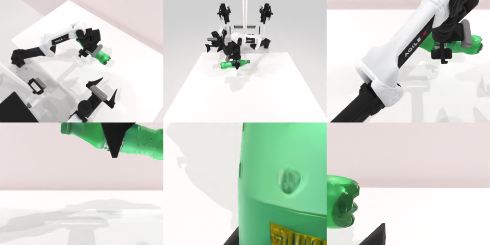

# Codex CLI + GPT-6 Luna (medium), limited rcb-limited/2.1, 60 min — robotwin_2_0_adjust_bottle-limited

Run: Harbor job `v21-gpt6luna-medium-limited`, trial `robotwin_2_0_adjust_bottle-limit__F8LSnYE`, 2026-09-28. Mode: **limited (robot as a service)**.

| | |
|---|---|
| result | **0** |
| agent time | 456 s |
| actions / physics steps | 49 / 2993 |
| tokens in / out | 1128987 / 15472 |
| verifier | `{"success": 0, "live_success": 0, "replay_success": 0, "deterministic": 1, "finalized": 1, "n_actions": 2993, "sim_steps": 2993, "steps": 49, "elapsed_s": 510.3, "video_rendered": 1, "live_video": 1, "live_frames": 109, "infra_error": 0, "sim_startups": 1, "grader_error": 0}` |
| verifier sandbox | separate |

## Replay (verifier's six-camera video)

[replay.mp4](replay.mp4) — top: world / observer / head; bottom: front / left wrist / right wrist.

## Analysis

【接近】左臂把瓶子抓起并抬离桌面（多行 `ee_pose`，平均 4.9 行），但腕部旋转规划失败，没能把瓶子立正；456 s 停止。

## Agent's last messages

- The wrist planner accepted a small tilt, but larger rotations and repositioning now fail its IK checks. I’m trying a small measured-joint adjustment to see whether the wrist can continue the rotation while keeping the bottle secured.
- The bottle remains held above the table, though the wrist cannot complete the upright rotation with the available planner. I’m updating `gen.py` to include the lower, successful grasp sequence so the recorded controller reproduces the pickup.
- The left arm lifted the bottle clear of the table. I saved the pickup controller at [gen.py](/app/output/gen.py) and the grasp video and observations in [episode](/app/output/episode).  The bottle stayed held, but the wrist planner couldn’t complete the rotation to make it upright.
