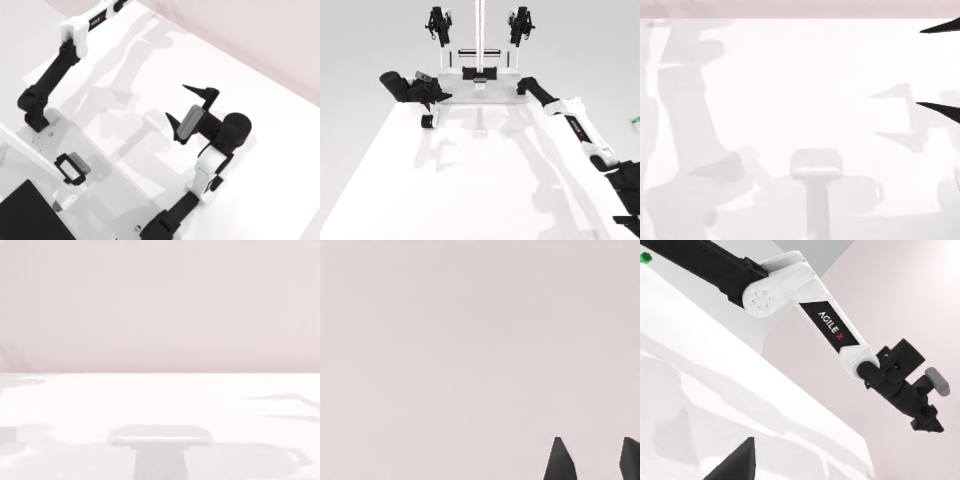

# Codex CLI + GPT-6 Luna, reasoning effort xhigh, limited rcb-limited/2.0, 60 min — robotwin_2_0_adjust_bottle-limited

Run: Harbor job `v2-gpt6luna-xhigh-limited`, trial `robotwin_2_0_adjust_bottle-limit__RcTUsR6`, 2026-09-28. Mode: **limited (robot as a service)**.

| | |
|---|---|
| result | **0** |
| agent time | 3107 s |
| actions / physics steps | 52 / 12272 |
| tokens in / out | 20959696 / 103956 |
| verifier | `{"success": 0, "live_success": 0, "replay_success": 0, "deterministic": 1, "finalized": 1, "n_actions": 12272, "sim_steps": 12272, "steps": 52, "elapsed_s": 3160.2, "video_rendered": 1, "grader_error": 0}` |
| verifier sandbox | separate |

## Replay (verifier's six-camera video)

[replay.mp4](replay.mp4) — top: world / observer / head; bottom: front / left wrist / right wrist.

## Analysis

【失败】瓶子被推到桌子远端、只露出一部分，左臂够不到；3106 s，52 次单行 `ee_pose`。medium 也失败（397 s 就停）。

## Agent's last messages

- The bottle is no longer visible in the overhead views, but the left fingers are now at the far-edge location from the last depth estimate. I’m closing there once and lifting slightly to check whether it is under the gripper.
- The bottle has moved beyond the reachable area and is only partly visible at the far table edge. I’m saving the camera-based controller at the requested path; the service has the full live action trajectory.
- I couldn’t complete the pickup. The bottle was displaced to the far edge and became only partly visible; the left arm could not reach it. I did not reset the episode.  I saved the camera-based controller at [gen.py](/app/output/gen.py). The service retains the live trajectory.
