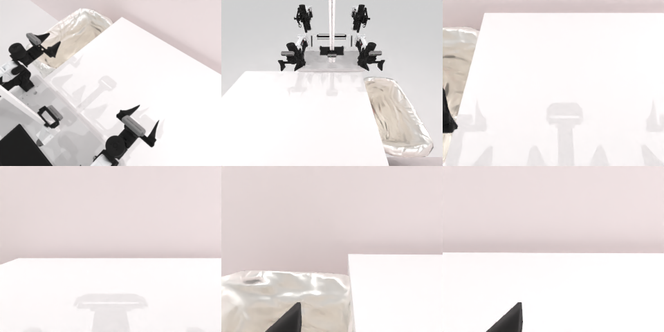

# Codex CLI + GPT-6 Luna (medium), limited rcb-limited/2.1, 60 min — robotwin_2_0_dump_bin_bigbin-limited

Run: Harbor job `v21-gpt6luna-medium-limited`, trial `robotwin_2_0_dump_bin_bigbin-lim__XUBonGa`, 2026-09-28. Mode: **limited (robot as a service)**.

| | |
|---|---|
| result | **0** |
| agent time | 615 s |
| actions / physics steps | 22 / 8252 |
| tokens in / out | 1925378 / 20655 |
| verifier | `{"success": 0, "live_success": 0, "replay_success": 0, "deterministic": 1, "finalized": 1, "n_actions": 8252, "sim_steps": 8252, "steps": 22, "elapsed_s": 675.5, "video_rendered": 1, "live_video": 1, "live_frames": 300, "infra_error": 0, "sim_startups": 1, "grader_error": 0}` |
| verifier sandbox | separate |

## Replay (verifier's six-camera video)

[replay.mp4](replay.mp4) — top: world / observer / head; bottom: front / left wrist / right wrist.

## Analysis

【误判/不确定】抓起小桶、倾倒、松开；agent 用了新的**测量夹爪开度**（抬起时约 0.18，判断夹住了桶），但最后看不清球是否进大桶，判定未通过；614 s。

## Agent's last messages

- The bin is released and the final frame still shows the tub partly blocked by the arm, so I can’t confirm the contents visually yet. I’m retracting the open gripper upward to expose the receptacle and check whether the bin and balls landed inside.
- The final parked view shows the pickup location clear and the arm out of the way; the bin is no longer at its starting spot. The tub’s reflective interior makes the balls hard to distinguish, so I can’t verify their count from RGB, but the grasp remained stable through the carry and the bin was tipped over the tub before release. I’m cleaning up `gen.py` now so it records the successful action sequence and its camera snapshots.
- I completed the grasp, carry, tip, release, and park sequence. The gripper opening stayed at about `0.18` during the lift, consistent with holding the bin. The final camera view is too reflective and partly occluded to confirm that the balls landed in the tub; the service also reported `done=false`.  I left the trajectory script at [gen.py](/app/output/gen.py) and saved the episode snapshots under `/app/output`.
