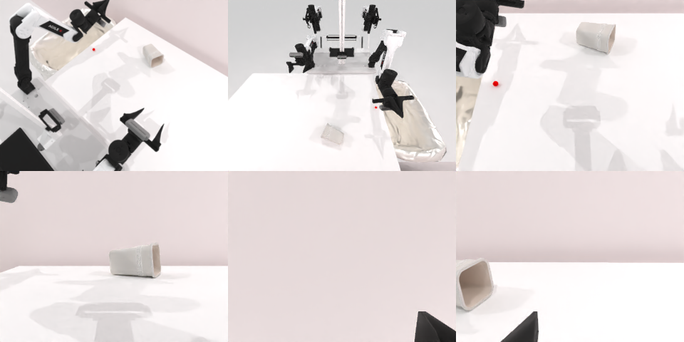

# Codex CLI + GPT-6 Luna (ChatGPT subscription), limited mode rcb-limited/2.0, 60 min — robotwin_2_0_dump_bin_bigbin-limited

Run: Harbor job `v2-gpt6luna-limited`, trial `robotwin_2_0_dump_bin_bigbin-lim__WxcpW4o`, 2026-09-25. Mode: **limited (robot as a service)**.

| | |
|---|---|
| result | **0** |
| agent time | 591 s |
| actions / physics steps | 59 / 12690 |
| tokens in / out | 1569326 / 18699 |
| verifier | `{"success": 0, "live_success": 0, "replay_success": 0, "deterministic": 1, "finalized": 1, "n_actions": 12690, "sim_steps": 12690, "steps": 59, "elapsed_s": 625.4, "video_rendered": 1, "grader_error": 0}` |
| verifier sandbox | separate |

## Replay (verifier's six-camera video)

[replay.mp4](replay.mp4) — top: world / observer / head; bottom: front / left wrist / right wrist.

## Analysis

【场景已坏→主动停】小桶被碰倒，至少一个球留在大桶外；59 次单行 `ee_pose`，7 次规划失败。591 s 停止。

## Agent's last messages

- The lateral correction aligns the tool over the bin, but it still did not lift; the remaining error appears to be vertical contact height. I’m testing a lower grasp point while keeping the approach centered, then checking whether the bin moves during a small lift.
- Depth unprojection puts the remaining visible ball near \((-0.23,\ 0.00,\ 0.75)\) in world coordinates. Earlier pushes passed beside it because of a lateral offset. I’ve cleared the arm and am making one low, aligned contact attempt before checking the scene again.
- I didn’t complete the task. The small bin was knocked onto its side, and at least one ball is still outside the receiving bin. Planner calls succeeded for several moves, but the bin never lifted and later pushes didn’t move the remaining ball into the large bin.  The episode and screenshots are saved under `/app/output/episode/`, and the script is at [gen.py](/app/output/gen.py).
