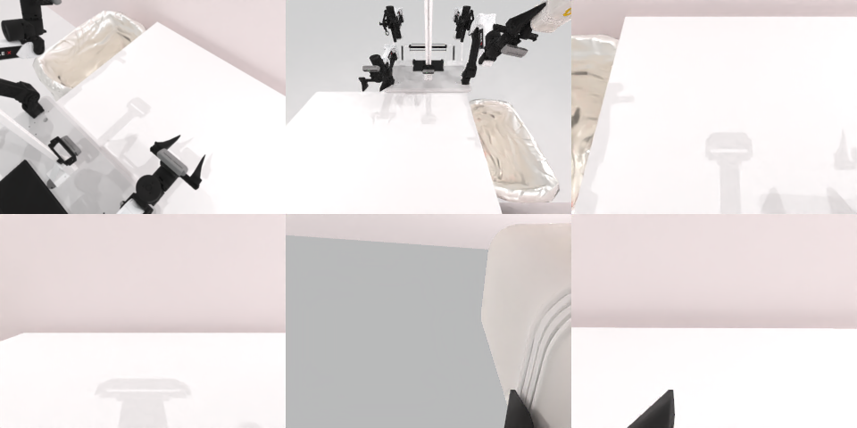

# Codex CLI + GPT-6 Luna, reasoning effort xhigh, limited rcb-limited/2.0, 60 min — robotwin_2_0_dump_bin_bigbin-limited

Run: Harbor job `v2-gpt6luna-xhigh-limited`, trial `robotwin_2_0_dump_bin_bigbin-lim__BmcHdph`, 2026-09-28. Mode: **limited (robot as a service)**.

| | |
|---|---|
| result | **1 (success)** |
| agent time | 2407 s |
| actions / physics steps | 35 / 9879 |
| tokens in / out | 6792660 / 81296 |
| verifier | `{"success": 1, "live_success": 1, "replay_success": 1, "deterministic": 1, "finalized": 1, "n_actions": 9879, "sim_steps": 9879, "steps": 35, "elapsed_s": 2011.1, "video_rendered": 1, "grader_error": 0}` |
| verifier sandbox | separate |

## Replay (verifier's six-camera video)

[replay.mp4](replay.mp4) — top: world / observer / head; bottom: front / left wrist / right wrist.

## Analysis

【成功，medium 失败】35 次 `ee_pose` 抓起小桶倾倒，2407 s 完成。medium 版 591 s 就因桶被碰倒而放弃。

## Agent's last messages

- The bin is securely held and tilted, but the overhead view doesn’t confirm where the opening sits relative to the tray. I’m checking the wrist and side views now; if needed, I’ll reposition the tilted bin over the tray before releasing the balls.
- The final 135° tilt returned `done: true, reason: "success"`, so the service graded the pour successfully. I’m writing the executed action sequence into `output/gen.py` now; the script will stop on that final response.
- The service reported `done: true, reason: success` after the final tilt. I saved the recorded trajectory script at [output/gen.py](/app/output/gen.py). I didn’t rerun it after the one-shot episode ended.
