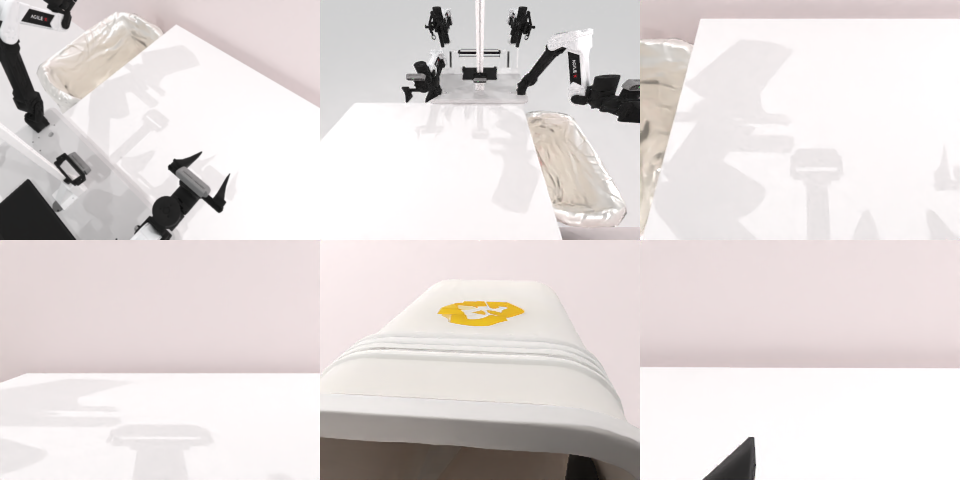

# Codex + GPT-6 Luna (ChatGPT subscription) — robotwin_2_0_dump_bin_bigbin

Run: Harbor job `gpt6luna-unlimited`, trial `robotwin_2_0_dump_bin_bigbin__dtXTw39`, 2026-09-24. Mode: **unlimited**.

| | |
|---|---|
| result | **1 (success)** |
| agent time | 95 s |
| actions / physics steps | 1734 / 1734 |
| tokens in / out | 201169 / 1883 |
| verifier | `{"success": 1, "all_success": 1, "deterministic": 1, "n_actions": 1734, "sim_steps": 1734, "grader_error": 0, "video_rendered": 1, "agent_resets": 3, "agent_sim_steps": 3468}` |
| verifier sandbox | separate |

Debugging footprint (self-reported by the agent's tooling log): 2 sessions, 3 resets, 3468 physics steps.

## Replay (verifier's six-camera video)

[replay.mp4](replay.mp4) — top: world / observer / head; bottom: front / left wrist / right wrist.

## Agent's last messages

- The success check requires the small bin to finish above z=1 and all five balls to land between z=0.13–0.25. I’m checking the instance’s exact geometry and grasp points so the trajectory can lift and tip the bin over the big bin.
- The small bin is near the center, and the big bin is at x=−0.45. The task already defines two left-arm target poses above the big bin for shaking/pouring, so I’ll use those with a planned rim grasp, then replay to check the actual result.
- The trajectory completed successfully on replay. It’s saved at [trajectory.npz](/app/output/trajectory.npz), and the script that generated it is [gen.py](/app/output/gen.py).
