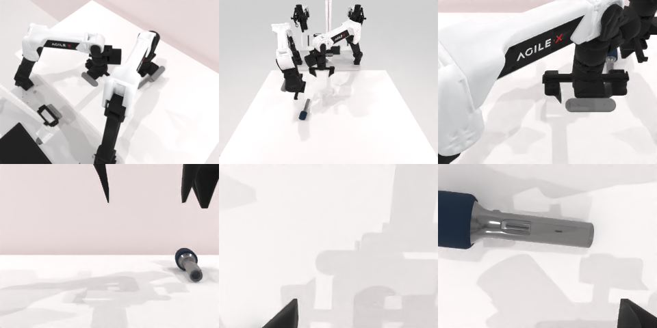

# Codex CLI + GPT-6 Luna (medium), limited rcb-limited/2.1, 60 min — robotwin_2_0_handover_mic-limited

Run: Harbor job `v21-gpt6luna-medium-limited`, trial `robotwin_2_0_handover_mic-limite__AJt9jgi`, 2026-09-28. Mode: **limited (robot as a service)**.

| | |
|---|---|
| result | **0** |
| agent time | 1635 s |
| actions / physics steps | 72 / 16288 |
| tokens in / out | 11598646 / 53817 |
| verifier | `{"success": 0, "live_success": 0, "replay_success": 0, "deterministic": 1, "finalized": 1, "n_actions": 16288, "sim_steps": 16288, "steps": 72, "elapsed_s": 1691.7, "video_rendered": 1, "live_video": 1, "live_frames": 653, "infra_error": 0, "sim_startups": 1, "grader_error": 0}` |
| verifier sandbox | separate |

## Replay (verifier's six-camera video)

[replay.mp4](replay.mp4) — top: world / observer / head; bottom: front / left wrist / right wrist.

## Analysis

【失败】麦克风始终没离开桌面；72 次单行 `ee_pose`、大量深度查询（38 次），1634 s。

## Agent's last messages

- The left reach caused another nudge; the microphone is now clearly visible near the left foreground. Depth places its shaft around `(-0.15, -0.05)`. I’m moving the left gripper to that measured location and will verify the lift in the front camera before attempting the handover again.
- The microphone is still on the table in the latest front view, so I’m not counting the narrowed gripper reading as a grasp. The service has recorded the full episode; I’m saving a clear waypoint and observation record in `/app/output/gen.py` and will report the outcome accurately.
- The episode did not succeed: the microphone remained on the table, and the service continued to report `done: false`. I saved a waypoint and observation record at [gen.py](/app/output/gen.py); the captured camera views and proprioception are in `/app/output/episode/`.
