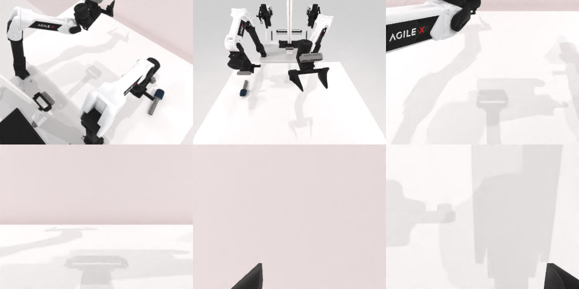

# Codex CLI + GPT-6 Luna (ChatGPT subscription), limited mode rcb-limited/2.0, 60 min — robotwin_2_0_handover_mic-limited

Run: Harbor job `v2-gpt6luna-limited`, trial `robotwin_2_0_handover_mic-limite__TLei3yH`, 2026-09-25. Mode: **limited (robot as a service)**.

| | |
|---|---|
| result | **0** |
| agent time | 836 s |
| actions / physics steps | 57 / 13839 |
| tokens in / out | 2465711 / 25328 |
| verifier | `{"success": 0, "live_success": 0, "replay_success": 0, "deterministic": 1, "finalized": 1, "n_actions": 13839, "sim_steps": 13839, "steps": 57, "elapsed_s": 877.2, "video_rendered": 1, "grader_error": 0}` |
| verifier sandbox | separate |

## Replay (verifier's six-camera video)

[replay.mp4](replay.mp4) — top: world / observer / head; bottom: front / left wrist / right wrist.

## Analysis

【反复失败→放弃】麦克风被多次碰移但从未留在夹爪里，交接根本没开始；836 s 停止。

## Agent's last messages

- The corrected side placement now crosses the microphone shaft, but the fingers stayed too high above the tabletop. I’m lowering the grasp to table height and checking whether it lifts before attempting another transfer.
- The low approach contacted the microphone and shifted it on the table, but it did not stay in the gripper. Its new position is slightly to the right and its long axis has turned. I’m updating the target from the new camera view and making one more pickup attempt.
- I couldn’t complete the handover. The microphone was repeatedly contacted and shifted on the table, but it never stayed in a gripper. The episode status remained `done: false`.  The initial control script is at [gen.py](/app/output/gen.py). Camera frames, proprioception, and action results are saved under [trajectory](/app/output/trajectory).
