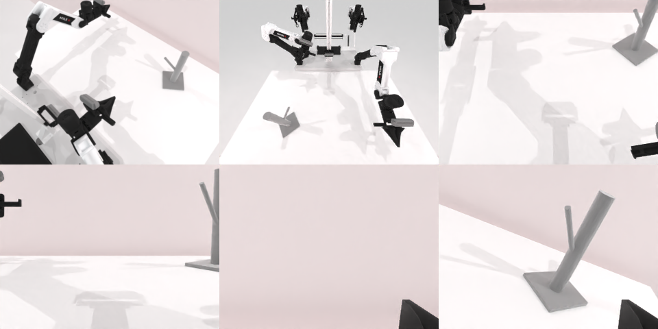

# Codex CLI + GPT-6 Luna (medium), limited rcb-limited/2.1, 60 min — robotwin_2_0_hanging_mug-limited

Run: Harbor job `v21-gpt6luna-medium-limited`, trial `robotwin_2_0_hanging_mug-limited__uHBiHk9`, 2026-09-28. Mode: **limited (robot as a service)**.

| | |
|---|---|
| result | **0** |
| agent time | 1097 s |
| actions / physics steps | 648 / 18490 |
| tokens in / out | 3653628 / 38114 |
| verifier | `{"success": 0, "live_success": 0, "replay_success": 0, "deterministic": 1, "finalized": 1, "n_actions": 18490, "sim_steps": 18490, "steps": 648, "elapsed_s": 1149.4, "video_rendered": 1, "live_video": 1, "live_frames": 698, "infra_error": 0, "sim_startups": 1, "grader_error": 0}` |
| verifier sandbox | separate |

## Replay (verifier's six-camera video)

[replay.mp4](replay.mp4) — top: world / observer / head; bottom: front / left wrist / right wrist.

## Analysis

【场景已坏→停】多次深度引导的接近都没抓起杯子，杯子被碰倒推向桌边；1096 s，平均每次 8.1 行。

## Agent's last messages

- The episode is still active, and the wide camera confirms the mug is on the near left side of the table. I’m making one more depth informed approach there, checking the arm’s actual motion before closing so the descent direction matches this pose.
- The wide view shows the mug shifted across the table during the earlier contacts, and the left arm is now on the opposite side of it. I’m using the right arm to recover the mug and return it to the center, then I’ll try the rack transfer from there.
- The episode is still active, but the mug was not picked up or hung. It was knocked onto its side and shifted toward the far edge of the table. I made several depth guided approaches and lift checks; none carried the mug, so I stopped before risking another uncontrolled move.  I saved the client script at [gen.py](/app/output/gen.py) and camera/action records under [the episode run](/app/runs/001). The latest saved observation shows the service is still running with about 2,466 seconds left.
