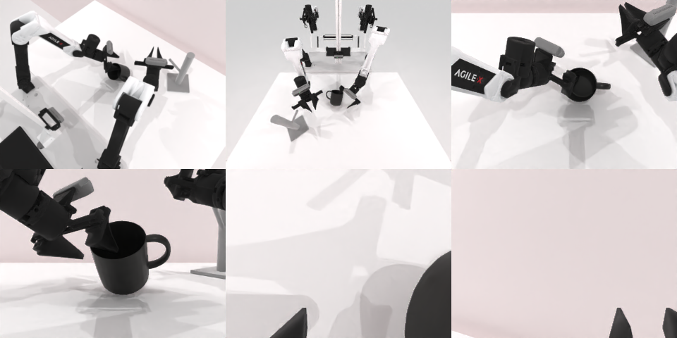

# Codex CLI + GPT-6 Luna, reasoning effort xhigh, limited rcb-limited/2.0, 60 min — robotwin_2_0_hanging_mug-limited

Run: Harbor job `v2-gpt6luna-xhigh-limited`, trial `robotwin_2_0_hanging_mug-limited__8L3CZ2R`, 2026-09-27. Mode: **limited (robot as a service)**.

| | |
|---|---|
| result | **0** |
| agent time | 3600 s |
| actions / physics steps | 41 / 9166 |
| tokens in / out | 9209362 / 82368 |
| verifier | `{"success": 0, "live_success": 0, "replay_success": 0, "deterministic": 1, "finalized": 1, "n_actions": 9166, "sim_steps": 9166, "steps": 41, "elapsed_s": 3666.7, "video_rendered": 1, "grader_error": 0}` |
| verifier sandbox | separate |

## Replay (verifier's six-camera video)

[replay.mp4](replay.mp4) — top: world / observer / head; bottom: front / left wrist / right wrist.

## Analysis

【超时】60 分钟用满仍在调整：左爪已侧抓举起杯子，正在转腕对准杯架时被截断。

## Agent's last messages

- The side-on orientation is reachable, but its end pose settles high and a lower approach plan failed. I’m switching to the robot-facing approach direction, which is closer to the arm’s natural reach, and will place the jaws at the mug’s sidewall height.
- The current contact is still above the cup’s sidewall: the jaws close fully and the mug remains upright. I’m lowering the same side approach a small amount to catch the body below the rim, then I’ll confirm grasp by lifting.
- The last lift raised the mug with the left gripper, so the side grasp is holding. I’m rotating the wrist about 20° to aim the handle toward the rack, then I’ll lower it onto the table center and check the release before switching arms.
