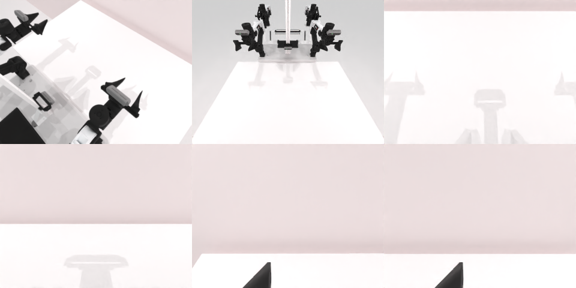

# Codex CLI + GPT-6 Luna (ChatGPT subscription), limited mode rcb-limited/2.0, 60 min — robotwin_2_0_lift_pot-limited

Run: Harbor job `v2-gpt6luna-limited`, trial `robotwin_2_0_lift_pot-limited__Zgugkac`, 2026-09-25. Mode: **limited (robot as a service)**.

| | |
|---|---|
| result | **0** |
| agent time | 812 s |
| actions / physics steps | 55 / 15036 |
| tokens in / out | 4143906 / 30550 |
| verifier | `{"success": 0, "live_success": 0, "replay_success": 0, "deterministic": 1, "finalized": 1, "n_actions": 15036, "sim_steps": 15036, "steps": 55, "elapsed_s": 844.3, "video_rendered": 1, "grader_error": 0}` |
| verifier sandbox | separate |

## Replay (verifier's six-camera video)

[replay.mp4](replay.mp4) — top: world / observer / head; bottom: front / left wrist / right wrist.

## Analysis

【场景已坏→主动停】多次抓取后锅离开桌面视野（被推走）；812 s 停止。双臂协同抬锅需要同时控制两只手，agent 仍是逐行单臂 `ee_pose`。

## Agent's last messages

- The top down wrist orientation is outside the arms’ reachable range, so that plan was rejected without moving them. I’m returning to a reachable horizontal wrist pose and lowering the contact point to the pot’s mid body before trying the lift again.
- The overhead view shows the grippers are still outside the handle ends by several centimeters. I’m moving both inward to center the fingers on the handles, then I’ll close and lift once more.
- I couldn’t complete the lift. The pot disappeared from the table view after repeated grasp attempts, and the episode is still active. I left the trajectory script at [gen.py](/app/output/gen.py).
