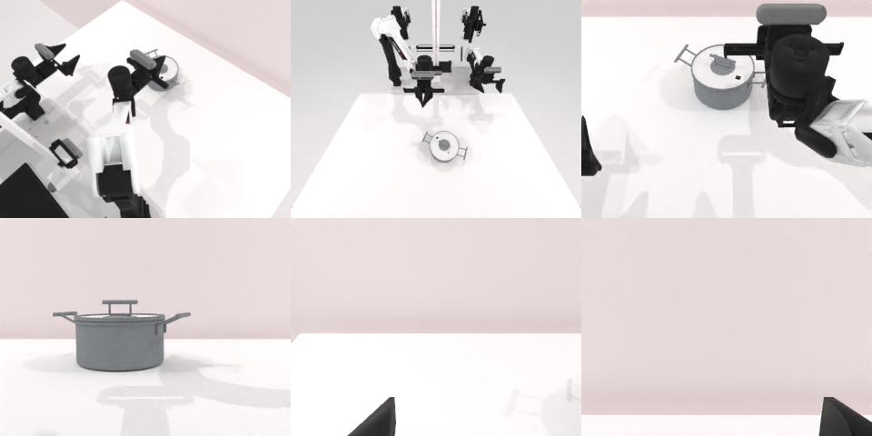

# Codex CLI + GPT-6 Luna, reasoning effort xhigh, limited rcb-limited/2.0, 60 min — robotwin_2_0_lift_pot-limited

Run: Harbor job `v2-gpt6luna-xhigh-limited`, trial `robotwin_2_0_lift_pot-limited__sJpasVv`, 2026-09-28. Mode: **limited (robot as a service)**.

| | |
|---|---|
| result | **0** |
| agent time | 3600 s |
| actions / physics steps | 64 / 18195 |
| tokens in / out | 14251745 / 89059 |
| verifier | `{"success": 0, "live_success": 0, "replay_success": 0, "deterministic": 1, "finalized": 1, "n_actions": 18195, "sim_steps": 18195, "steps": 64, "elapsed_s": 3658.9, "video_rendered": 1, "grader_error": 0}` |
| verifier sandbox | separate |

## Replay (verifier's six-camera video)

[replay.mp4](replay.mp4) — top: world / observer / head; bottom: front / left wrist / right wrist.

## Analysis

【超时】两侧把手多次尝试，锅始终留在桌上；12 次规划失败。

## Agent's last messages

- The staged descent found an asymmetry: the right wrist can reach the handle height, while the left planner repeatedly stops about 4 cm above it. The pot is still upright. I’m making one final approach from the robot’s original side and will use the right grip if the left path still fails.
- The one-hand test also left the pot on the table. I have roughly a minute and a half left, so I’m making one last right-handle adjustment toward the loop center, then I’ll stop when the episode ends or the time budget runs out.
- The final right-handle attempt also left the pot on the table. The service reports about 36 seconds remaining and no success flag. I’m leaving the arms raised and letting the episode reach its time limit; `/app/output/gen.py` contains the last controller.
