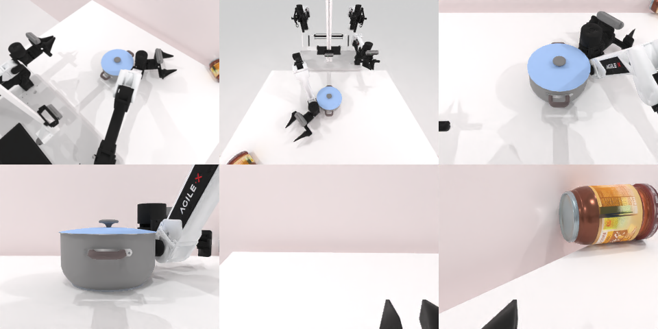

# Codex CLI + GPT-6 Luna (medium), limited rcb-limited/2.1, 60 min — robotwin_2_0_move_can_pot-limited

Run: Harbor job `v21-gpt6luna-medium-limited`, trial `robotwin_2_0_move_can_pot-limite__v2hPrdM`, 2026-09-28. Mode: **limited (robot as a service)**.

| | |
|---|---|
| result | **0** |
| agent time | 1238 s |
| actions / physics steps | 125 / 13847 |
| tokens in / out | 6133377 / 31343 |
| verifier | `{"success": 0, "live_success": 0, "replay_success": 0, "deterministic": 1, "finalized": 1, "n_actions": 13847, "sim_steps": 13847, "steps": 125, "elapsed_s": 1298.2, "video_rendered": 1, "live_video": 1, "live_frames": 555, "infra_error": 0, "sim_startups": 1, "grader_error": 0}` |
| verifier sandbox | separate |

## Replay (verifier's six-camera video)

[replay.mp4](replay.mp4) — top: world / observer / head; bottom: front / left wrist / right wrist.

## Analysis

【失败，2.0 medium 成功】罐子几次在抬起时滑出夹爪，之后改推也没推到锅旁；125 次动作，1238 s。

## Agent's last messages

- The right gripper is now at can height, and its measured opening stopped around 0.60 while commanded closed, which is consistent with it holding an object. I’ll raise it a short distance and verify the can moved with the gripper before carrying it toward the pot.
- The can did not stay in the gripper during the lift checks, and the later sweep did not bring it beside the pot. It appears at the far edge of the available views, while the pot remains upright. I’m saving the control script and the episode observations for the record.
- I could not complete the task. The can did not stay in the gripper during lift attempts, and the later push attempts did not move it beside the pot. The pot remained upright.  The control script is saved at [gen.py](/app/output/gen.py), and the final camera observations are in `/app/runs/push3/`.
