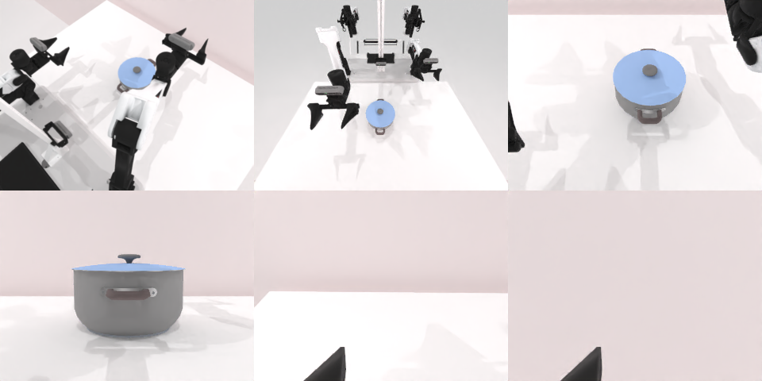

# Codex + GPT-6 Luna (ChatGPT subscription) — robotwin_2_0_move_can_pot-limited

Run: Harbor job `gpt6luna-limited`, trial `robotwin_2_0_move_can_pot-limite__APs9j2c`, 2026-09-24. Mode: **limited (robot as a service)**.

| | |
|---|---|
| result | **0** |
| agent time | 525 s |
| actions / physics steps | 48 / 10822 |
| tokens in / out | 2178814 / 19825 |
| verifier | `{"success": 0, "live_success": 0, "replay_success": 0, "deterministic": 1, "finalized": 1, "n_actions": 10822, "sim_steps": 10822, "steps": 48, "elapsed_s": 683.0, "video_rendered": 1, "grader_error": 0}` |
| verifier sandbox | separate |

## Replay (verifier's six-camera video)

[replay.mp4](replay.mp4) — top: world / observer / head; bottom: front / left wrist / right wrist.

## Analysis

抓起后罐子从两台固定相机视野消失（被举出画面），放到锅边后不可见；agent 因无法确认而停止，48 步。

## Agent's last messages

- After the last lift, the can disappeared from both static camera views, which is consistent with it being held beyond the image edge. I’ll carry it left to the space beside the pot, then lower and release while watching the static cameras.
- The carry plan succeeded and the arm reached the space beside the pot. The can is obscured at the high placement pose, so I’ll lower to table height, open the gripper, and inspect whether it settles beside the pot.
- The episode is still open, but I couldn’t confirm a successful placement. The can disappeared from the cameras after the last grasp attempt, and it wasn’t visible beside the pot after release. I stopped without further moves so I wouldn’t risk disturbing the scene.  The controller is at [gen.py](/app/output/gen.py). The trajectory and observation images are in `/app/output`.
