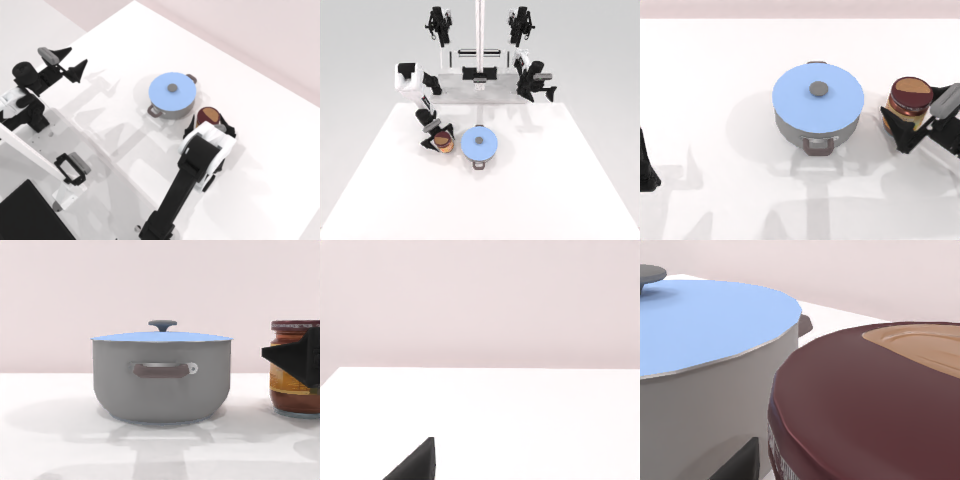

# Codex + GPT-6 Luna (ChatGPT subscription) — robotwin_2_0_move_can_pot

Run: Harbor job `gpt6luna-unlimited`, trial `robotwin_2_0_move_can_pot__TnMvPC3`, 2026-09-24. Mode: **unlimited**.

| | |
|---|---|
| result | **1 (success)** |
| agent time | 569 s |
| actions / physics steps | 2216 / 2216 |
| tokens in / out | 1377707 / 8336 |
| verifier | `{"success": 1, "all_success": 1, "deterministic": 1, "n_actions": 2216, "sim_steps": 2216, "grader_error": 0, "video_rendered": 1, "agent_resets": 28, "agent_sim_steps": 37525}` |
| verifier sandbox | separate |

Debugging footprint (self-reported by the agent's tooling log): 12 sessions, 28 resets, 37525 physics steps.

## Replay (verifier's six-camera video)

[replay.mp4](replay.mp4) — top: world / observer / head; bottom: front / left wrist / right wrist.

## Analysis

成功（重判后）。首轮 verifier 容器出现 CUDA 报错（与并发作业抢 GPU），用同一 grader 在新容器重判得 1；agent 自己发现罐子落点偏 +x 6.8 cm 并补偿了一次。

## Agent's last messages

- The success condition is stricter than “beside the pot”: the can must land on the correct x side, within 3.5 cm in y, remain at table height, and finish at a specific roll/pitch. I’m checking the frozen poses and will tune the placement orientation against those exact checks.
- The first grasp point is reachable and holds the can. The first placement stayed upright and on the table, but it settled about 6.8 cm farther toward +x than the requested target, so it missed the 20 cm x bound. I’m compensating for that measured offset and replaying to verify the score.
- Success. The replayed trajectory scores `success: true` and is saved at [trajectory.npz](/app/output/trajectory.npz). The generator is at [gen.py](/app/output/gen.py).
