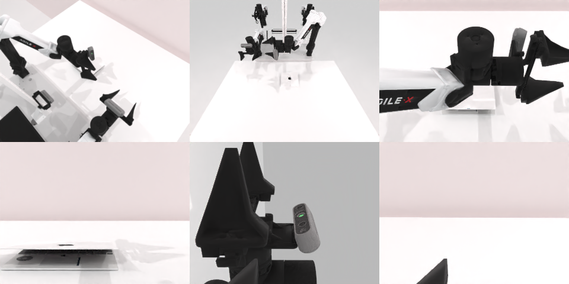

# Codex CLI + GPT-6 Luna (ChatGPT subscription), limited mode rcb-limited/2.0, 60 min — robotwin_2_0_open_laptop-limited

Run: Harbor job `v2-gpt6luna-limited`, trial `robotwin_2_0_open_laptop-limited__piioWwq`, 2026-09-25. Mode: **limited (robot as a service)**.

| | |
|---|---|
| result | **0** |
| agent time | 270 s |
| actions / physics steps | 19 / 5456 |
| tokens in / out | 755170 / 10457 |
| verifier | `{"success": 0, "live_success": 0, "replay_success": 0, "deterministic": 1, "finalized": 1, "n_actions": 5456, "sim_steps": 5456, "steps": 19, "elapsed_s": 286.9, "video_rendered": 1, "grader_error": 0}` |
| verifier sandbox | separate |

## Replay (verifier's six-camera video)

[replay.mp4](replay.mp4) — top: world / observer / head; bottom: front / left wrist / right wrist.

## Analysis

【未坏就放弃】几次向上掀盖的动作规划成功但盖子不动，269 s 就停止，场景完全可恢复却只用了 7% 的预算——典型的过早放弃。

## Agent's last messages

- The first lift cleared the laptop without catching the lid. I’m lowering the open gripper to the near edge and applying a second controlled upward stroke, then I’ll check whether the lid angle changed.
- The side approach did not reach its target. I’ll try a top down pinch at the laptop’s near left corner, close the gripper at lid height, and lift once.
- I used the left arm for several planned approaches and upward strokes. The planner accepted the final motions, but the camera still showed no clear lid movement, and the service reported `done: false`; I can’t confirm the laptop opened.  I saved the controller at [gen.py](/app/output/gen.py) and the recorded camera and proprioception outputs under `/app/output/`.
