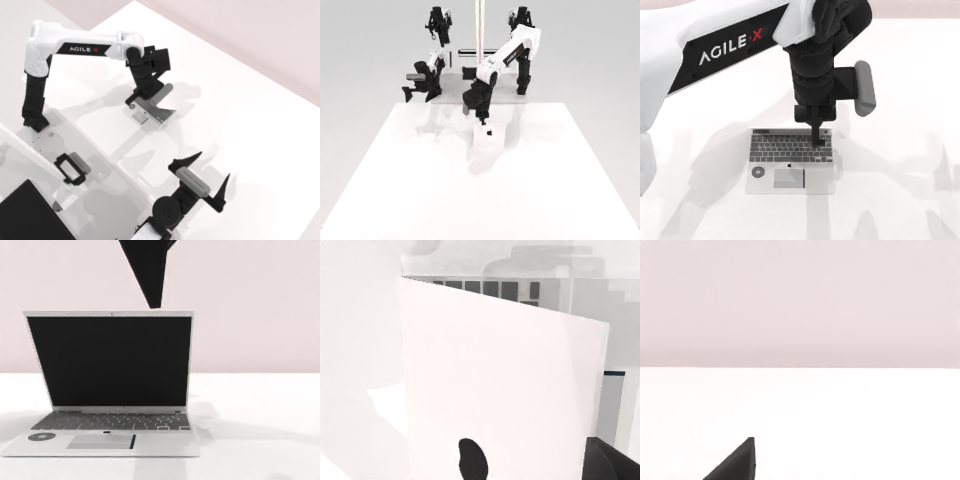

# Codex CLI + GPT-6 Luna, reasoning effort xhigh, limited rcb-limited/2.0, 60 min — robotwin_2_0_open_laptop-limited

Run: Harbor job `v2-gpt6luna-xhigh-limited`, trial `robotwin_2_0_open_laptop-limited__ZGC4JjA`, 2026-09-28. Mode: **limited (robot as a service)**.

| | |
|---|---|
| result | **1 (success)** |
| agent time | 2453 s |
| actions / physics steps | 114 / 10825 |
| tokens in / out | 9504375 / 77316 |
| verifier | `{"success": 1, "live_success": 1, "replay_success": 1, "deterministic": 1, "finalized": 1, "n_actions": 10825, "sim_steps": 10825, "steps": 114, "elapsed_s": 2375.4, "video_rendered": 1, "grader_error": 0}` |
| verifier sandbox | separate |

## Replay (verifier's six-camera video)

[replay.mp4](replay.mp4) — top: world / observer / head; bottom: front / left wrist / right wrist.

## Analysis

【成功，medium 失败】2453 s，多次慢弧线掀盖后成功（最后一段用了 40 行 `joint_position`）。medium 版 269 s 就放弃。

## Agent's last messages

- A slow upward arc that also advances the gripper toward the hinge has opened the screen substantially. The lid is following the gripper now; I’m continuing that arc in small steps and checking for the service’s success signal after each move.
- The simulator returned `done: true` with reason `success`, and the final front view shows the lid upright. I’m updating `/app/output/gen.py` to retain the successful downward grasp and two slow opening arcs as a compact episode record.
- Success: the service reported `done: true` with reason `success`, and the final camera view shows the laptop screen upright.  Saved the controller reference at [gen.py](/app/output/gen.py). The final trajectory and camera frames are in [phase_slow_arc2](/app/output/phase_slow_arc2).
