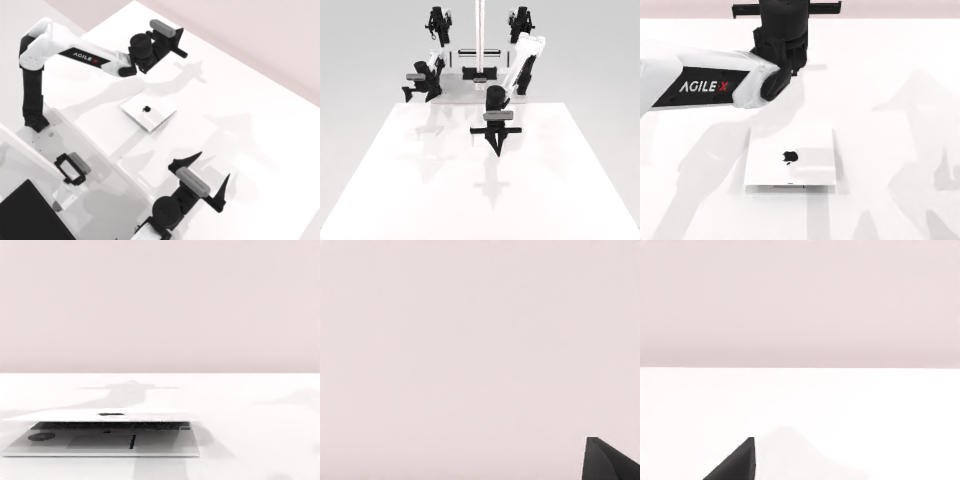

# Codex + GPT-6 Luna (ChatGPT subscription) — robotwin_2_0_open_laptop-limited

Run: Harbor job `gpt6luna-limited`, trial `robotwin_2_0_open_laptop-limited__pL2dM3g`, 2026-09-24. Mode: **limited (robot as a service)**.

| | |
|---|---|
| result | **0** |
| agent time | 517 s |
| actions / physics steps | 54 / 11095 |
| tokens in / out | 1821624 / 22042 |
| verifier | `{"success": 0, "live_success": 0, "replay_success": 0, "deterministic": 1, "finalized": 1, "n_actions": 11095, "sim_steps": 11095, "steps": 54, "elapsed_s": 689.1, "video_rendered": 1, "grader_error": 0}` |
| verifier sandbox | separate |

## Replay (verifier's six-camera video)

[replay.mp4](replay.mp4) — top: world / observer / head; bottom: front / left wrist / right wrist.

## Analysis

多次从上方接近盖子边缘抬起，盖子不动（指尖没有插到盖子下沿）；7 个动作被规划器拒绝；54 步放弃。

## Agent's last messages

- I’ve returned the left arm to its home pose after the failed planner approach. The laptop is still on the table, and the arm is free. I’m trying the near free edge with a fresh, straight approach from above.
- The rotated approach also failed to catch the lid. I’m making one final attempt at the center of the free edge using the normal downward wrist orientation, which gives the gripper a better chance to get a fingertip under the lip.
- I did not succeed in opening the laptop. The left arm made several approaches and lifts, but the lid did not visibly move; the episode remains active and reports `done=False`. I saved the client sequence at [gen.py](/app/output/gen.py).
