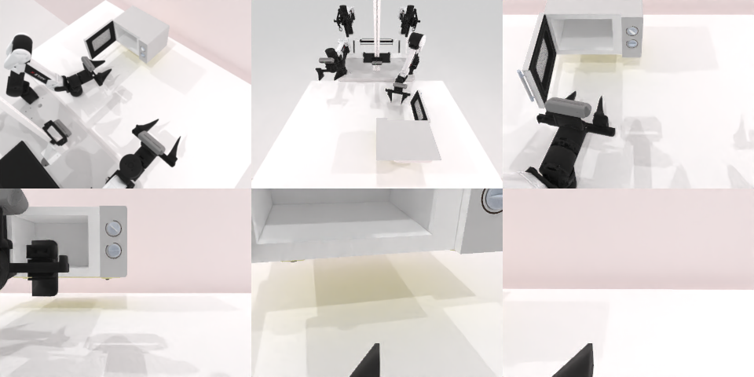

# Codex CLI + GPT-6 Luna (medium), limited rcb-limited/2.1, 60 min — robotwin_2_0_open_microwave-limited

Run: Harbor job `v21-gpt6luna-medium-limited`, trial `robotwin_2_0_open_microwave-limi__fngWY3B`, 2026-09-28. Mode: **limited (robot as a service)**.

| | |
|---|---|
| result | **0 as graded by Harbor; 1 after offline re-verification** (finalize bug, see Analysis) |
| agent time | 2322 s |
| actions / physics steps | 180 / 40384 |
| tokens in / out | 15530609 / 67510 |
| verifier | `{"success": 0, "live_success": 1, "replay_success": 0, "deterministic": 0, "finalized": 0, "n_actions": 0, "sim_steps": 40384, "steps": 180, "elapsed_s": 2378.5, "video_rendered": 0, "live_video": 0, "live_frames": 0, "infra_error": 0, "sim_startups": 1, "grader_error": 0}` |
| verifier sandbox | separate |

## Replay (verifier's six-camera video)

[replay.mp4](replay.mp4) — top: world / observer / head; bottom: front / left wrist / right wrist.

## Analysis

【成功（重判）】服务端实时判定成功，验证回放也成功且确定性一致（episode.jsonl 记录），但 40384 步的 episode 渲染两段视频超出了收集等待时间，final.json 没写完，Harbor 记为 0。离线用两次独立回放复核为成功（`verifier/regrade_offline.json`）。bug 已修：判定写盘先于视频渲染。

## Agent's last messages

- The arm has moved off the handle again, and the static view still shows only a narrow opening. I’m returning to the raised bar on the door’s right edge, holding the measured contact width, and pulling straight outward to test that handle directly.
- The wrist view places the raised handle at the door’s left edge; the strip near the buttons is the hinge side. I’m repositioning to that left edge and keeping a partial grip through the outward arc so the door stays open while it moves.
- The microwave door opened to the service’s success condition. The episode ended with `done: true` and `reason: success`.  The control script is saved at [gen.py](/app/output/gen.py).
