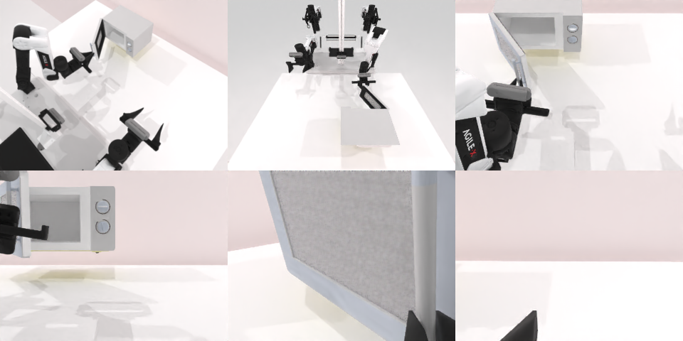

# Codex CLI + GPT-6 Luna (ChatGPT subscription), limited mode rcb-limited/2.0, 60 min — robotwin_2_0_open_microwave-limited

Run: Harbor job `v2-gpt6luna-limited`, trial `robotwin_2_0_open_microwave-limi__oMUCgeZ`, 2026-09-25. Mode: **limited (robot as a service)**.

| | |
|---|---|
| result | **1 (success)** |
| agent time | 657 s |
| actions / physics steps | 54 / 8431 |
| tokens in / out | 2957031 / 27420 |
| verifier | `{"success": 1, "live_success": 1, "replay_success": 1, "deterministic": 1, "finalized": 1, "n_actions": 8431, "sim_steps": 8431, "steps": 54, "elapsed_s": 626.9, "video_rendered": 1, "grader_error": 0}` |
| verifier sandbox | separate |

## Replay (verifier's six-camera video)

[replay.mp4](replay.mp4) — top: world / observer / head; bottom: front / left wrist / right wrist.

## Analysis

【成功】唯一混用两种动作类型的任务：21 次 `ee_pose` 接近把手 + 6 次多行 `joint_position` 拉门；657 s 完成。

## Agent's last messages

- The door is only partly open, and the handle has moved with it. The prior pull overshot the hinge arc and lost contact. I’ve measured the handle’s new position from the front depth view and will regrasp there, then pull along the remaining arc.
- The service reports `done: true` with reason `success`. I’m updating `/app/output/gen.py` into a clean record of the successful approach and hinge-following pull.
- Microwave door opened successfully. The service returned `done: true` and reason `success`.  The recorded controller is at [gen.py](/app/output/gen.py). Episode observations and action captures are saved under `/app/output`.
