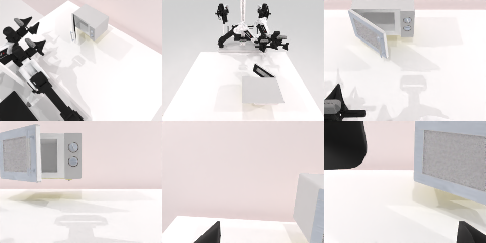

# Codex CLI + GPT-6 Luna, reasoning effort xhigh, limited rcb-limited/2.0, 60 min — robotwin_2_0_open_microwave-limited

Run: Harbor job `v2-gpt6luna-xhigh-limited`, trial `robotwin_2_0_open_microwave-limi__Eh9K9eK`, 2026-09-27. Mode: **limited (robot as a service)**.

| | |
|---|---|
| result | **0** |
| agent time | 3589 s |
| actions / physics steps | 106 / 8633 |
| tokens in / out | 10212812 / 74460 |
| verifier | `{"success": 0, "live_success": 0, "replay_success": 0, "deterministic": 1, "finalized": 1, "n_actions": 8633, "sim_steps": 8633, "steps": 106, "elapsed_s": 3641.4, "video_rendered": 1, "grader_error": 0}` |
| verifier sandbox | separate |

## Replay (verifier's six-camera video)

[replay.mp4](replay.mp4) — top: world / observer / head; bottom: front / left wrist / right wrist.

## Analysis

【接近，medium 成功】门拉开了一部分但没到判定的开合角度；3588 s。medium 版 657 s 成功，说明单次噪声很大。

## Agent's last messages

- The last move appears to have swung the door back toward closed, so I’m returning to the original handle position and repeating the outward pull direction that first opened it. There are about 8½ minutes left.
- The right arm was wedged, so I retracted it with a slow joint-space motion; it is now clear and the door has returned closed. About 3½ minutes remain. I’m making one final controlled grasp and pull from the original handle position.
- The microwave door opened partway, but the service still reported `done: false` at timeout, so I can’t confirm the 60% hinge-range target was reached. The final control script is at [gen.py](/app/output/gen.py).
