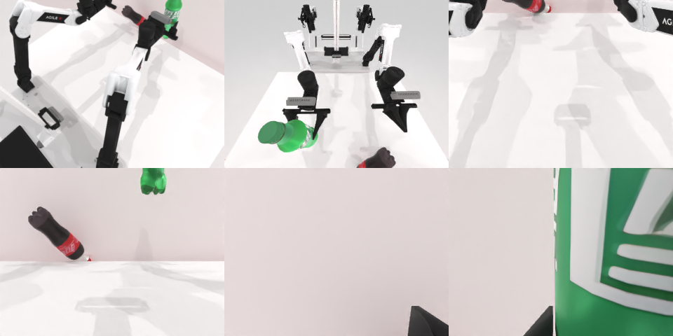

# Codex CLI + GPT-6 Luna (medium), limited rcb-limited/2.1, 60 min — robotwin_2_0_pick_dual_bottles-limited

Run: Harbor job `v21-gpt6luna-medium-limited`, trial `robotwin_2_0_pick_dual_bottles-l__LY36sTQ`, 2026-09-28. Mode: **limited (robot as a service)**.

| | |
|---|---|
| result | **0** |
| agent time | 191 s |
| actions / physics steps | 6 / 1327 |
| tokens in / out | 483082 / 6777 |
| verifier | `{"success": 0, "live_success": 0, "replay_success": 0, "deterministic": 1, "finalized": 1, "n_actions": 1327, "sim_steps": 1327, "steps": 6, "elapsed_s": 284.7, "video_rendered": 1, "live_video": 1, "live_frames": 55, "infra_error": 0, "sim_startups": 1, "grader_error": 0}` |
| verifier sandbox | separate |

## Replay (verifier's six-camera video)

[replay.mp4](replay.mp4) — top: world / observer / head; bottom: front / left wrist / right wrist.

## Analysis

【失败】右爪抓住绿瓶，红瓶被碰歪；只 6 次动作、191 s 就停。

## Agent's last messages

- Depth places the red bottle near `(-0.22, 0.17)` and the green one near `(0.11, 0.19)` in table coordinates. I’ll approach each from the robot side at bottle-body height, close around it, and lift to check whether the gripper holds it.
- Both motion plans succeeded. After lifting, the left gripper remains partly open (`0.18`), consistent with an object between its fingers; the right is much more open (`0.82`), so I’m checking the final camera views before deciding whether it needs a small correction.
- Completed the episode with successful motion plans. The green bottle appears secured in the right gripper; the red bottle looks tilted near the table, so I can’t confirm the left arm picked it up successfully.  The episode script is at [gen.py](/app/output/gen.py).
