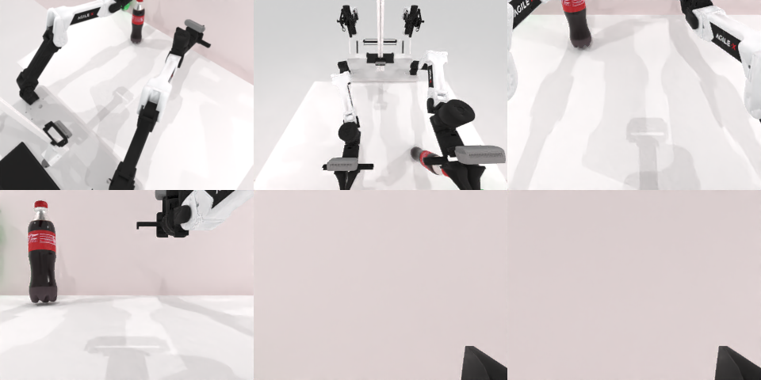

# Codex CLI + GPT-6 Luna (ChatGPT subscription), limited mode rcb-limited/2.0, 60 min — robotwin_2_0_pick_dual_bottles-limited

Run: Harbor job `v2-gpt6luna-limited`, trial `robotwin_2_0_pick_dual_bottles-l__o4jRuFf`, 2026-09-25. Mode: **limited (robot as a service)**.

| | |
|---|---|
| result | **0** |
| agent time | 115 s |
| actions / physics steps | 8 / 2332 |
| tokens in / out | 319771 / 4529 |
| verifier | `{"success": 0, "live_success": 0, "replay_success": 0, "deterministic": 1, "finalized": 1, "n_actions": 2332, "sim_steps": 2332, "steps": 8, "elapsed_s": 167.2, "video_rendered": 1, "grader_error": 0}` |
| verifier sandbox | separate |

## Replay (verifier's six-camera video)

[replay.mp4](replay.mp4) — top: world / observer / head; bottom: front / left wrist / right wrist.

## Analysis

【场景已坏→主动停】右臂接近时把绿瓶碰倒，左臂抓红瓶落空；只 7 次动作，114 s 停止。

## Agent's last messages

- The scene has two upright bottles, one red on the left and one green on the right. The initial images show them near the far edge of the table. I’m using the supplied camera calibration and depth to estimate their tabletop positions before moving either arm.
- The first attempt didn’t secure either bottle: the left arm completed its lift but the red bottle stayed on the table, and the green bottle tipped over during the right arm’s failed approach. I’m checking the post action camera and proprio to adjust the grasp targets and recover both bottles if possible.
- The episode ran, and the controller and action recordings are saved in [gen.py](/app/output/gen.py) and `/app/runs/`.  The attempt did not pick up either bottle. The green bottle tipped during the right arm’s approach, and the red bottle remained on the table after the left arm closed and lifted. The service reported planner failures for the right arm on the initial approach and final lift; later plans succeeded, but the bottles were still not grasped.
