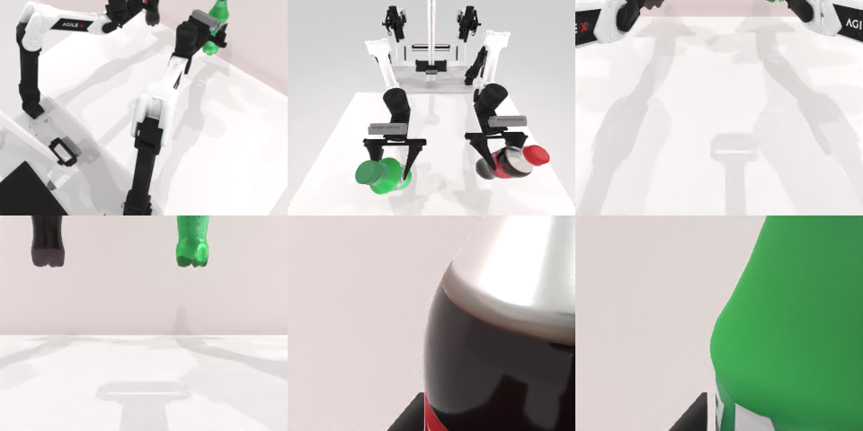

# Codex CLI + GPT-6 Luna, reasoning effort xhigh, limited rcb-limited/2.0, 60 min (rerun: the first trial's sim service did not start) — robotwin_2_0_pick_dual_bottles-limited

Run: Harbor job `v2-gpt6luna-xhigh-limited-rerun`, trial `robotwin_2_0_pick_dual_bottles-l__96kfs6K`, 2026-09-28. Mode: **limited (robot as a service)**.

| | |
|---|---|
| result | **0** |
| agent time | 658 s |
| actions / physics steps | 16 / 1548 |
| tokens in / out | 806561 / 19453 |
| verifier | `{"success": 0, "live_success": 0, "replay_success": 0, "deterministic": 1, "finalized": 1, "n_actions": 1548, "sim_steps": 1548, "steps": 16, "elapsed_s": 761.9, "video_rendered": 1, "grader_error": 0}` |
| verifier sandbox | separate |

## Replay (verifier's six-camera video)

[replay.mp4](replay.mp4) — top: world / observer / head; bottom: front / left wrist / right wrist.

## Analysis

【重跑后失败】首次 trial 因 sim 服务未启动作废；重跑中双臂各抓起一个瓶子并抬离桌面，但未达到判定高度，agent 657 s 就停止。

## Agent's last messages

- Both arms reached their approach poses successfully, and the final approach stayed level at bottle-body height. I’m closing both grippers now; I’ll check the camera frames before lifting to confirm the bottles stayed upright and are between the fingers.
- The lift succeeded: both bottles are visibly suspended above the table while the grippers remain closed. I’m holding that position briefly to confirm they stay secure, then I’ll write the recorded trajectory into `/app/output/gen.py`.
- Both arms reached their bottles, closed, and lifted them clear of the table. The service reported successful lift plans; its `done` field remained false after a 1-second hold.  Saved the controller script at [gen.py](/app/output/gen.py). No reset was used.
