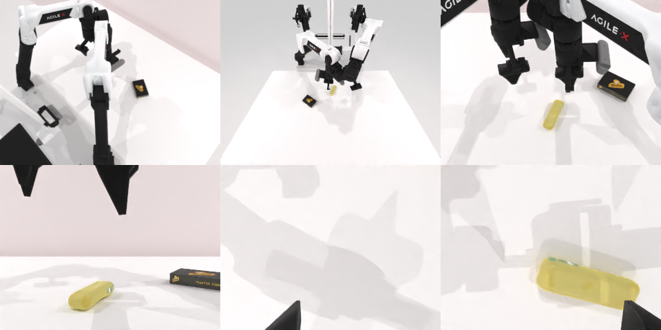

# Codex CLI + GPT-6 Luna (medium), limited rcb-limited/2.1, 60 min — robotwin_2_0_place_a2b_right-limited

Run: Harbor job `v21-gpt6luna-medium-limited`, trial `robotwin_2_0_place_a2b_right-lim__cTSgFvq`, 2026-09-28. Mode: **limited (robot as a service)**.

| | |
|---|---|
| result | **0** |
| agent time | 246 s |
| actions / physics steps | 10 / 2025 |
| tokens in / out | 537995 / 5103 |
| verifier | `{"success": 0, "live_success": 0, "replay_success": 0, "deterministic": 1, "finalized": 1, "n_actions": 2025, "sim_steps": 2025, "steps": 10, "elapsed_s": 300.6, "video_rendered": 1, "live_video": 1, "live_frames": 82, "infra_error": 0, "sim_startups": 1, "grader_error": 0}` |
| verifier sandbox | separate |

## Replay (verifier's six-camera video)

[replay.mp4](replay.mp4) — top: world / observer / head; bottom: front / left wrist / right wrist.

## Analysis

【过早放弃】黄色物体没被抓起，搬运时规划失败；246 s 就停。

## Agent's last messages

- The overhead view shows a yellow handled object to the left of a black box. I’m treating the yellow object as A and the box as B, and checking calibrated depth before choosing the arm and approach.
- Depth places A near the table center and B slightly to its right, so the left arm is best positioned to pick A. I’ll use a top down grasp, lift clear, carry A to the open space on B’s right, then release and inspect the result.
- I wasn’t able to complete the placement. The yellow object remained in its starting position, and the service reported planning failures when carrying it toward the right side of B. The episode is still open.  The control script is saved at [gen.py](/app/output/gen.py), with observations and execution records under `/app/runs/place_a2b_right_*`.
