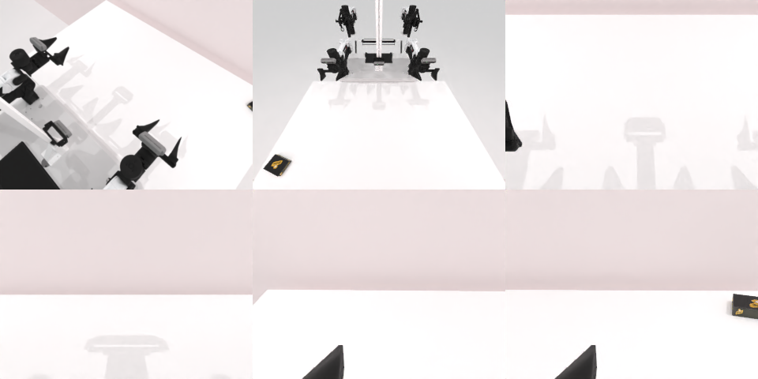

# Codex CLI + GPT-6 Luna, limited rcb-limited/2.0, 60 min, instruction + 'Persistence' paragraph (ablation, not the shipped instruction) — robotwin_2_0_place_a2b_right-limited

Run: Harbor job `v2-gpt6luna-limited-persist`, trial `robotwin_2_0_place_a2b_right-lim__tZWMr7j`, 2026-09-25. Mode: **limited (robot as a service)**.

| | |
|---|---|
| result | **0** |
| agent time | 3545 s |
| actions / physics steps | 473 / 203941 |
| tokens in / out | 20854866 / 117011 |
| verifier | `{"success": 0, "live_success": 0, "replay_success": 0, "deterministic": 1, "finalized": 1, "n_actions": 203941, "sim_steps": 203941, "steps": 473, "elapsed_s": 3570.6, "video_rendered": 1, "grader_error": 0}` |
| verifier sandbox | separate |

## Replay (verifier's six-camera video)

[replay.mp4](replay.mp4) — top: world / observer / head; bottom: front / left wrist / right wrist.

## Analysis

【加提示后仍失败】用到 3544 s（181 次动作、34 次规划失败），恢复过程中把物体推向桌子远端，最后的够取被规划器拒绝。

## Agent's last messages

- The placement and recovery attempts have not triggered success, and the remaining objects are outside the end effector’s reachable workspace. I’ve kept `/app/output/gen.py` with the contact-sweep controller and am watching the episode until its one minute cutoff.
- The episode remains active with about 3 minutes 45 seconds left and no success signal. The visible object has stayed at the edge during idle observation, and the final attempted reach was rejected by the planner. I’m continuing the cutoff monitoring as requested.
- The episode ended at the one minute cutoff with `done: false`; placement was not confirmed. Camera feedback showed the objects had been pushed toward the far table edge, and the planner rejected the final recovery reaches.  The control script is saved at [gen.py](/app/output/gen.py).
