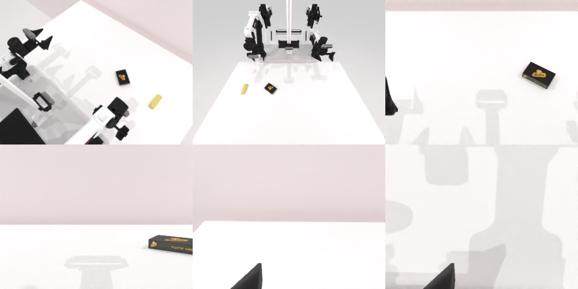

# Codex CLI + GPT-6 Luna, reasoning effort xhigh, limited rcb-limited/2.0, 60 min — robotwin_2_0_place_a2b_right-limited

Run: Harbor job `v2-gpt6luna-xhigh-limited`, trial `robotwin_2_0_place_a2b_right-lim__iegzgQC`, 2026-09-28. Mode: **limited (robot as a service)**.

| | |
|---|---|
| result | **0** |
| agent time | 3416 s |
| actions / physics steps | 61 / 11773 |
| tokens in / out | 17245917 / 121038 |
| verifier | `{"success": 0, "live_success": 0, "replay_success": 0, "deterministic": 1, "finalized": 1, "n_actions": 11773, "sim_steps": 11773, "steps": 61, "elapsed_s": 3467.3, "video_rendered": 1, "grader_error": 0}` |
| verifier sandbox | separate |

## Replay (verifier's six-camera video)

[replay.mp4](replay.mp4) — top: world / observer / head; bottom: front / left wrist / right wrist.

## Analysis

【误判成功】agent 认为黄色物体已放在深色包裹右侧，但判定未通过；3415 s，零规划失败。

## Agent's last messages

- A is now resting on the table to the right of B, and the arm is clear. The service still reports `done: false`; I’ll let it settle once more, then increase the rightward spacing if it still does not register success.
- A stayed with the gripper during the second transfer, so I’ve moved it farther right to give the placement a wider margin. I’ve released it there; I’m clearing the arm and checking the settled scene and episode result.
- The yellow item is resting on the table to the robot-right of the dark package, with a clear gap. The robot service still reports `done: false` and no reason, so I can’t confirm that the grader registered success.  I saved the controller at [gen.py](/app/output/gen.py).
