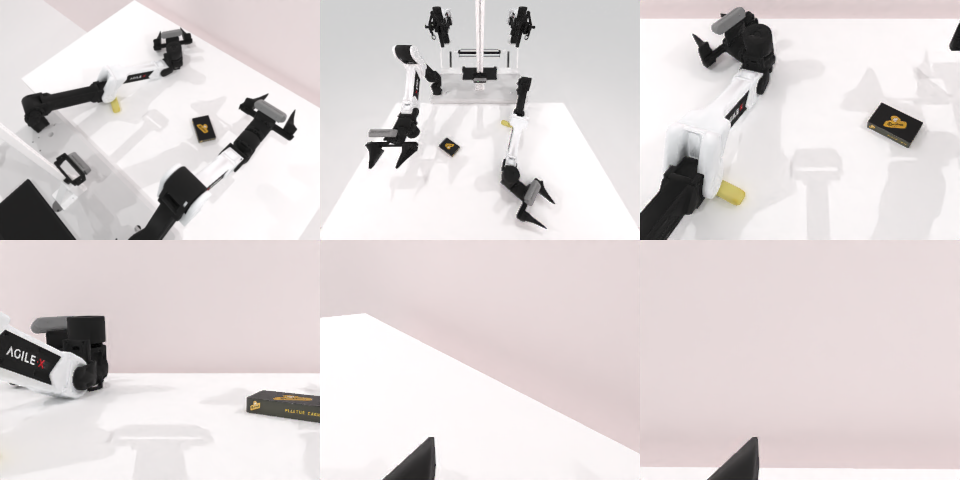

# Codex + GPT-6 Luna (ChatGPT subscription) — robotwin_2_0_place_a2b_right-limited

Run: Harbor job `gpt6luna-limited`, trial `robotwin_2_0_place_a2b_right-lim__mRPrQ3p`, 2026-09-24. Mode: **limited (robot as a service)**.

| | |
|---|---|
| result | **0** |
| agent time | 318 s |
| actions / physics steps | 59 / 12871 |
| tokens in / out | 887548 / 13700 |
| verifier | `{"success": 0, "live_success": 0, "replay_success": 0, "deterministic": 1, "finalized": 1, "n_actions": 12871, "sim_steps": 12871, "steps": 59, "elapsed_s": 481.9, "video_rendered": 1, "grader_error": 0}` |
| verifier sandbox | separate |

## Replay (verifier's six-camera video)

[replay.mp4](replay.mp4) — top: world / observer / head; bottom: front / left wrist / right wrist.

## Analysis

第一次抓取落空后物体被蹭偏；换左臂够不到放置点（规划器拒绝 13 个跨桌/低位动作），右臂再抓又空；最后想用推的，物体仍留在盒子左侧。59 步。

## Agent's last messages

- The left arm cannot reach the chosen placement point; its planner rejects that move. The object may have shifted during the left-arm pickup attempt, so I’m checking the current view and will use the right arm for the final placement if I can recover it.
- The right-arm recovery also missed the grasp, and the yellow object has been nudged farther left. I can still use the right arm to try a controlled table-level push toward the box’s right side; the direct arm paths to that region are available.
- I wasn’t able to complete the placement. The yellow object remained left of the box after the pickup attempts, and the arm planners rejected several low or cross-table moves. The episode is still active, but the object has been nudged during the attempts.  The control script is at [gen.py](/app/output/gen.py). It records the initial eight-action attempt; it does not include the later recovery actions.
