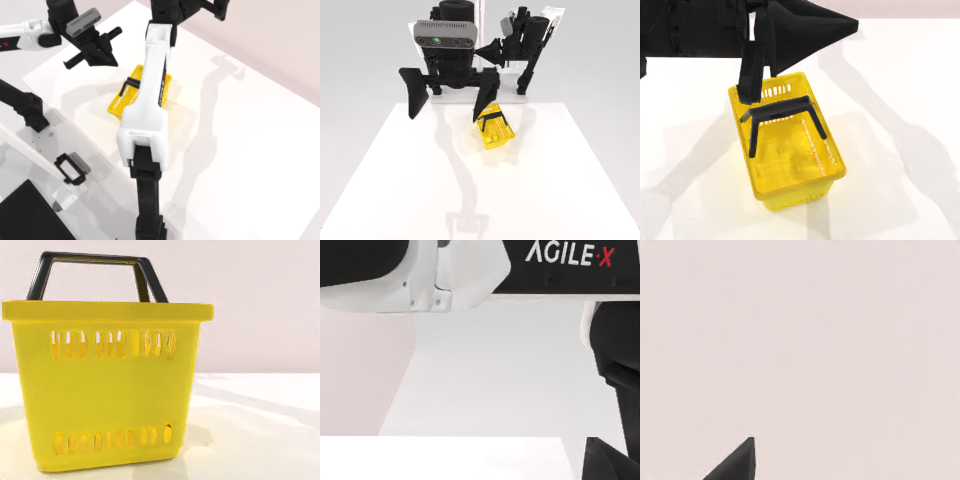

# Codex CLI + GPT-6 Luna (medium), limited rcb-limited/2.1, 60 min — robotwin_2_0_place_can_basket-limited

Run: Harbor job `v21-gpt6luna-medium-limited`, trial `robotwin_2_0_place_can_basket-li__K7KaAii`, 2026-09-28. Mode: **limited (robot as a service)**.

| | |
|---|---|
| result | **0** |
| agent time | 717 s |
| actions / physics steps | 42 / 9216 |
| tokens in / out | 3744065 / 29056 |
| verifier | `{"success": 0, "live_success": 0, "replay_success": 0, "deterministic": 1, "finalized": 1, "n_actions": 9216, "sim_steps": 9216, "steps": 42, "elapsed_s": 781.9, "video_rendered": 1, "live_video": 1, "live_frames": 370, "infra_error": 0, "sim_startups": 1, "grader_error": 0}` |
| verifier sandbox | separate |

## Replay (verifier's six-camera video)

[replay.mp4](replay.mp4) — top: world / observer / head; bottom: front / left wrist / right wrist.

## Analysis

【场景已坏→停】第一次抓取把罐子碰倒，之后恢复失败；716 s。

## Agent's last messages

- The basket stayed on the table after the handle attempt, so that grasp missed. I’m making one lower, centered grasp on the handle and will verify basket motion in the front camera before ending the episode.
- I found the handle’s actual position in the overhead depth map: it is higher and farther toward the robot than my earlier estimate. I’ll align the left gripper to that measured point, close around the bar, and check whether the basket rises.
- The episode did not reach success. The can was knocked over during the first grasp attempt and remained outside the basket; the basket also stayed on the table. I stopped after repeated camera-guided recovery attempts.  The control script is at [gen.py](/app/output/gen.py). Per-action videos and metadata are saved under `/app/runs/`.
