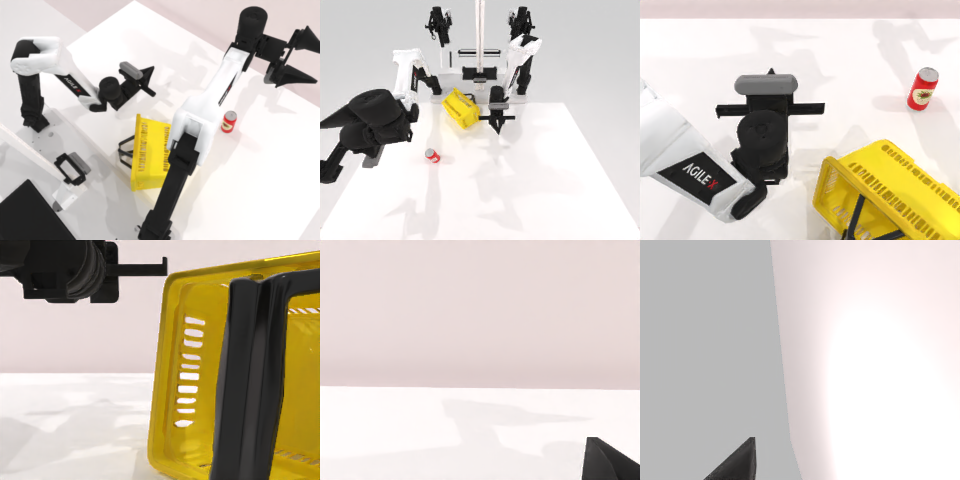

# Codex CLI + GPT-6 Luna (ChatGPT subscription), limited mode rcb-limited/2.0, 60 min — robotwin_2_0_place_can_basket-limited

Run: Harbor job `v2-gpt6luna-limited`, trial `robotwin_2_0_place_can_basket-li__NPA5VSn`, 2026-09-25. Mode: **limited (robot as a service)**.

| | |
|---|---|
| result | **0** |
| agent time | 343 s |
| actions / physics steps | 29 / 7214 |
| tokens in / out | 1313393 / 12283 |
| verifier | `{"success": 0, "live_success": 0, "replay_success": 0, "deterministic": 1, "finalized": 1, "n_actions": 7214, "sim_steps": 7214, "steps": 29, "elapsed_s": 375.6, "video_rendered": 1, "grader_error": 0}` |
| verifier sandbox | separate |

## Replay (verifier's six-camera video)

[replay.mp4](replay.mp4) — top: world / observer / head; bottom: front / left wrist / right wrist.

## Analysis

【场景已坏→主动停】罐子没抓起，提篮子时篮子被弄翻；343 s 停止。

## Agent's last messages

- The can is still visible on the table, so the right gripper hasn’t secured it. I’m switching to the basket lift while preserving the current scene; I’ll use the left arm to grip the basket’s near wall and lift it upright.
- I’m testing an overhead grasp orientation now, which should let the gripper close around the can’s upper sides. The earlier side approaches missed, and I’m checking the service response before deciding whether the episode is still controllable.
- The episode did not succeed. The can remained on the table, and the basket tipped during the lift attempt. I saved the control record at [gen.py](/app/output/gen.py); its comments note that the live episode should not be replayed.
