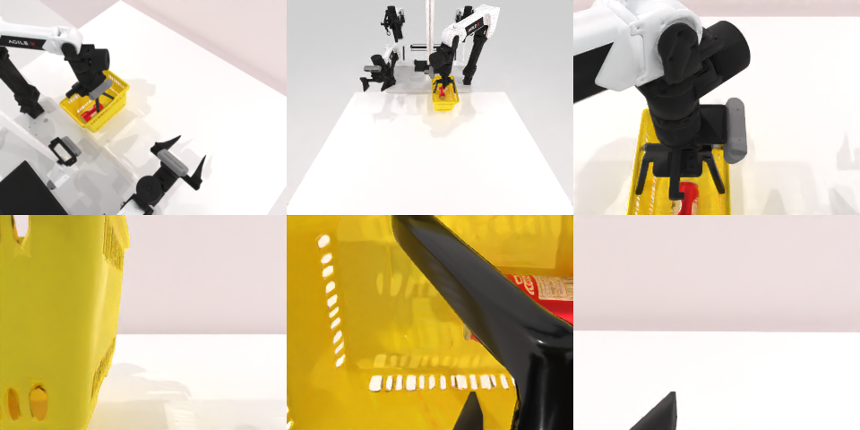

# Codex CLI + GPT-6 Luna, reasoning effort xhigh, limited rcb-limited/2.0, 60 min — robotwin_2_0_place_can_basket-limited

Run: Harbor job `v2-gpt6luna-xhigh-limited`, trial `robotwin_2_0_place_can_basket-li__3NBWNKP`, 2026-09-28. Mode: **limited (robot as a service)**.

| | |
|---|---|
| result | **1 (success)** |
| agent time | 2668 s |
| actions / physics steps | 256 / 11910 |
| tokens in / out | 17398597 / 98591 |
| verifier | `{"success": 1, "live_success": 1, "replay_success": 1, "deterministic": 1, "finalized": 1, "n_actions": 11910, "sim_steps": 11910, "steps": 256, "elapsed_s": 2495.9, "video_rendered": 1, "grader_error": 0}` |
| verifier sandbox | separate |

## Replay (verifier's six-camera video)

[replay.mp4](replay.mp4) — top: world / observer / head; bottom: front / left wrist / right wrist.

## Analysis

【成功，medium 失败】2668 s，12 次多行 `joint_position`（最多 60 行）配合 `ee_pose`，先放罐再提篮子。

## Agent's last messages

- The basket shifted during the earlier handle attempt. Depth now locates its handle near x = −0.08 m, y = −0.23 m, so I’m using that updated camera measurement for the grasp. The can remains inside.
- The service has returned `done=True` with reason `success` after the left-arm lift. I’m saving the control script now with the can placement, corrected top-down handle approach, and the completed run summary.
- The episode completed successfully: the service returned `done=True`, `reason=success` after the basket lift.  The control script is saved at [gen.py](/app/output/gen.py), and the terminal result is in [basket_lift4/meta.json](/app/output/basket_lift4/meta.json).
