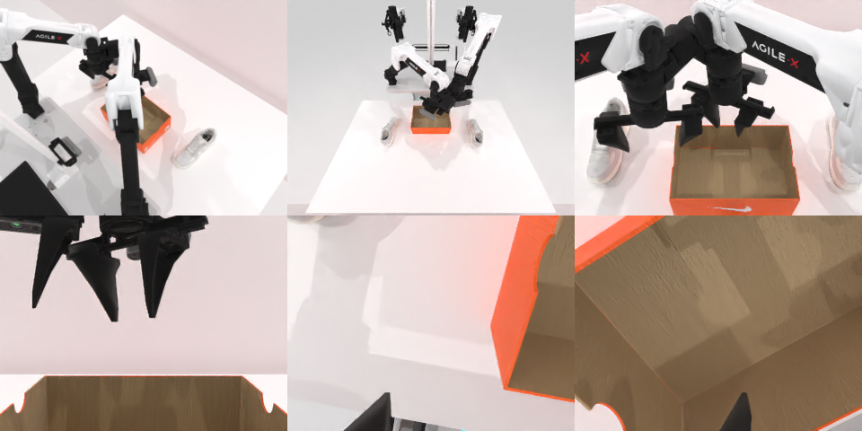

# Codex CLI + GPT-6 Luna (medium), limited rcb-limited/2.1, 60 min — robotwin_2_0_place_dual_shoes-limited

Run: Harbor job `v21-gpt6luna-medium-limited`, trial `robotwin_2_0_place_dual_shoes-li__C8MArsj`, 2026-09-28. Mode: **limited (robot as a service)**.

| | |
|---|---|
| result | **0** |
| agent time | 445 s |
| actions / physics steps | 27 / 5054 |
| tokens in / out | 1217759 / 12542 |
| verifier | `{"success": 0, "live_success": 0, "replay_success": 0, "deterministic": 1, "finalized": 1, "n_actions": 5054, "sim_steps": 5054, "steps": 27, "elapsed_s": 509.5, "video_rendered": 1, "live_video": 1, "live_frames": 200, "infra_error": 0, "sim_startups": 1, "grader_error": 0}` |
| verifier sandbox | separate |

## Replay (verifier's six-camera video)

[replay.mp4](replay.mp4) — top: world / observer / head; bottom: front / left wrist / right wrist.

## Analysis

【失败】右臂抬高/搬运被规划器拒绝，两只鞋都在盒外；444 s。

## Agent's last messages

- The arm reaches the shoe’s horizontal position at a safe height, but the planner can’t lower it while keeping the starting wrist orientation. I’m changing the wrist to point the gripper down, which lets the end-effector stay above the table while the fingers descend onto the shoe.
- The placement check shows the shoes are still outside the box. I found the positioning error: after rotating the wrist downward, its 12 cm offset is vertical, so the earlier horizontal approach point was too far forward. I’m correcting the table depth and making another attempt on the right shoe.
- The episode is still running, but the task is **not complete**: the last camera view shows both shoes outside the box. The planner rejected the higher lift and carry for the right arm, and the grasp did not hold through the attempted move.  I left the control script at [gen.py](/app/output/gen.py) and saved the camera observations and action results under `/app/output/`.
