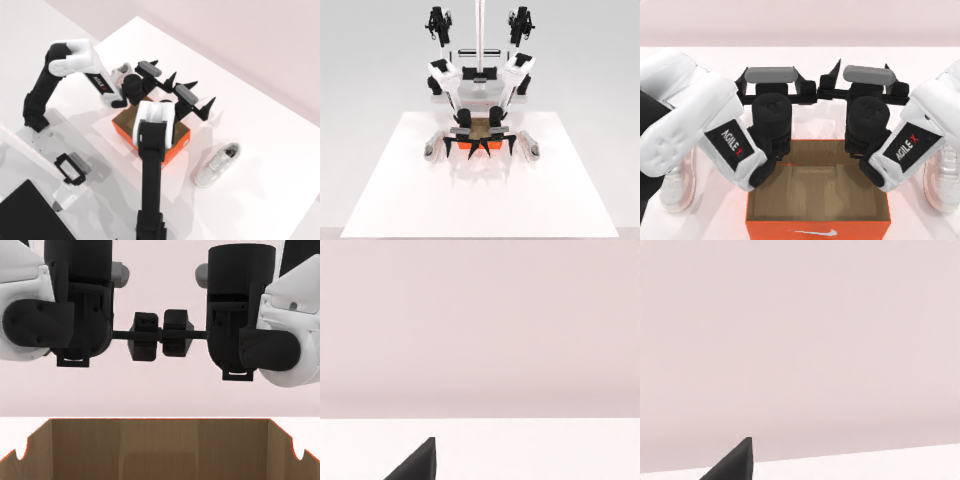

# Codex CLI + GPT-6 Luna (ChatGPT subscription), limited mode rcb-limited/2.0, 60 min — robotwin_2_0_place_dual_shoes-limited

Run: Harbor job `v2-gpt6luna-limited`, trial `robotwin_2_0_place_dual_shoes-li__BdQaDUn`, 2026-09-25. Mode: **limited (robot as a service)**.

| | |
|---|---|
| result | **0** |
| agent time | 571 s |
| actions / physics steps | 43 / 9434 |
| tokens in / out | 2436433 / 21693 |
| verifier | `{"success": 0, "live_success": 0, "replay_success": 0, "deterministic": 1, "finalized": 1, "n_actions": 9434, "sim_steps": 9434, "steps": 43, "elapsed_s": 603.6, "video_rendered": 1, "grader_error": 0}` |
| verifier sandbox | separate |

## Replay (verifier's six-camera video)

[replay.mp4](replay.mp4) — top: world / observer / head; bottom: front / left wrist / right wrist.

## Analysis

【未坏就放弃】右鞋仍在盒外，左鞋被手臂挡住看不清；11 次规划失败后 571 s 停止。

## Agent's last messages

- The overhead observer still shows the right shoe outside the box. The left shoe is partly hidden by the arm, so its position is unclear. I’m repositioning the right arm through the visible shoe’s location and pushing it inward, then I’ll take a final overhead view.
- The final overhead view still shows the right shoe outside the box, and the left shoe is obscured rather than confirmed inside. The episode remains active, but the grasp and push attempts have not produced a visible placement. I’m saving the attempted control sequence in `gen.py` so the episode record and script stay together.
- The episode is still active, but I couldn’t confirm either shoe entering the box. The overhead view showed the right shoe still outside, and the left shoe was obscured by an arm. The grasp and push attempts did not visibly complete the task.  I saved the attempted control sequence at [gen.py](/app/output/gen.py) and syntax-checked it. The service also retains the episode trajectory.
