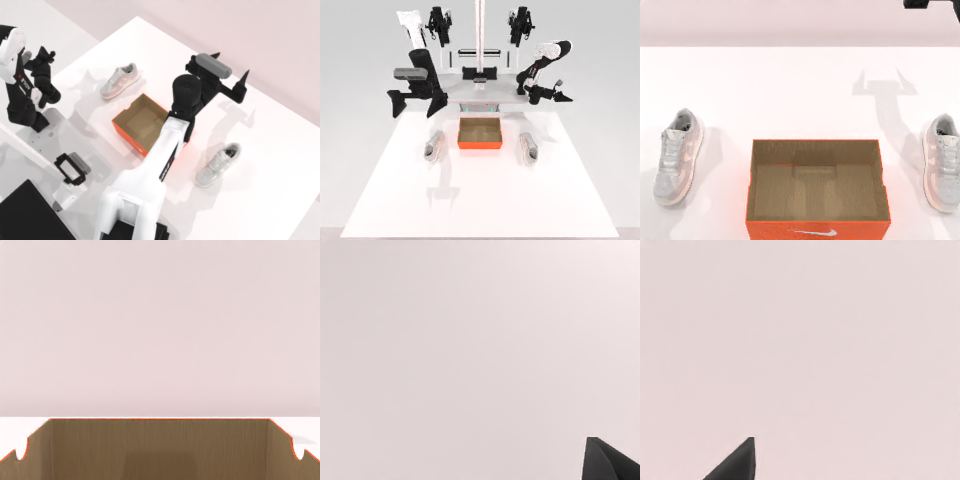

# Codex CLI + GPT-6 Luna, reasoning effort xhigh, limited rcb-limited/2.0, 60 min — robotwin_2_0_place_dual_shoes-limited

Run: Harbor job `v2-gpt6luna-xhigh-limited`, trial `robotwin_2_0_place_dual_shoes-li__9JydAhg`, 2026-09-27. Mode: **limited (robot as a service)**.

| | |
|---|---|
| result | **0** |
| agent time | 3476 s |
| actions / physics steps | 156 / 24657 |
| tokens in / out | 23639466 / 125509 |
| verifier | `{"success": 0, "live_success": 0, "replay_success": 0, "deterministic": 1, "finalized": 1, "n_actions": 24657, "sim_steps": 24657, "steps": 156, "elapsed_s": 3520.3, "video_rendered": 1, "grader_error": 0}` |
| verifier sandbox | separate |

## Replay (verifier's six-camera video)

[replay.mp4](replay.mp4) — top: world / observer / head; bottom: front / left wrist / right wrist.

## Analysis

【失败】两只鞋都还在桌上；3475 s，10 次规划失败。

## Agent's last messages

- The final side approach also remained just outside the graspable range. I’m saving the camera-based action sequence to `/app/output/gen.py` now; the shoes are still visible on the table, so I can’t report a successful placement.
- I have about four minutes left. The side grasp reached 4 cm above the shoe but the planner rejected the lower target, so I’m using the arm’s own joint readings for a small controlled descent from that reachable pose, then I’ll try one final lift.
- I did not complete the placement. At the last observation, both shoes were still on the table and the service reported `done: false` with about 126 seconds remaining.  The action script is saved at [gen.py](/app/output/gen.py). Camera captures and action records are under `/app/runs/001/`.
