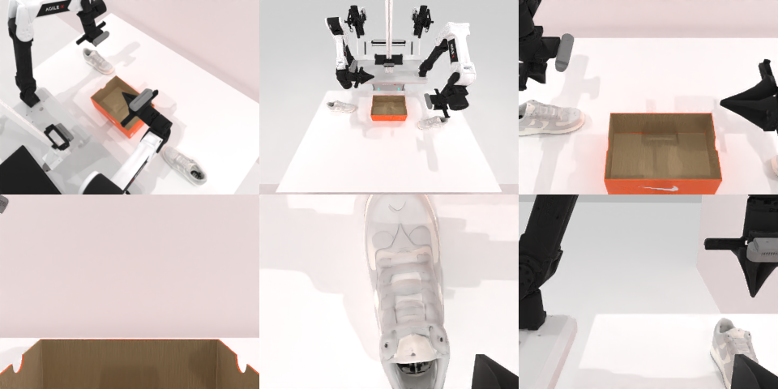

# Codex + GPT-6 Luna (ChatGPT subscription) — robotwin_2_0_place_dual_shoes-limited

Run: Harbor job `gpt6luna-limited`, trial `robotwin_2_0_place_dual_shoes-li__LRqFMPC`, 2026-09-24. Mode: **limited (robot as a service)**.

| | |
|---|---|
| result | **0** |
| agent time | 1567 s |
| actions / physics steps | 143 / 42944 |
| tokens in / out | 11249674 / 62964 |
| verifier | `{"success": 0, "live_success": 0, "replay_success": 0, "deterministic": 1, "finalized": 1, "n_actions": 42944, "sim_steps": 42944, "steps": 143, "elapsed_s": 1747.4, "video_rendered": 1, "grader_error": 0}` |
| verifier sandbox | separate |

## Replay (verifier's six-camera video)

[replay.mp4](replay.mp4) — top: world / observer / head; bottom: front / left wrist / right wrist.

## Analysis

143 个动作、26 分钟，是 limited 里最努力的一次：鞋心估计偏 6 cm，反复调整腕部朝向让指尖跨过鞋子，多次夹到但抬不起来；两只鞋都没进鞋盒。

## Agent's last messages

- The jaw direction matters: when I rotated the left wrist gradually, the gripper tips finally crossed the shoe. A low close nudged it, but it stayed on the table. I’m using that jaw direction with an adjusted approach point to compensate for the wrist offset, then I’ll see whether it can hold through a lift.
- The placement attempt is still incomplete: both shoes remain outside the shoebox, and the episode has not reported success. I’m preserving the episode controller at the requested path and clearing temporary camera/debug captures from `/app/output`.
- The episode did not reach success. At the last observation, both shoes were still outside the shoebox; the episode had not ended.  I left the controller at [gen.py](/app/output/gen.py). It now refuses to replay actions if the episode has already started.
