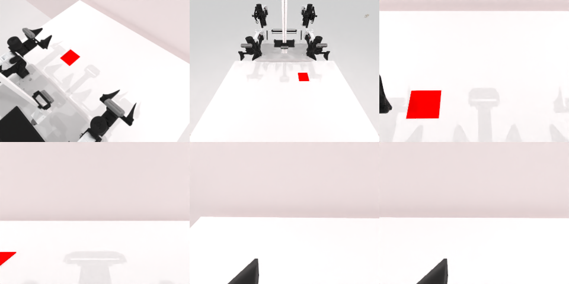

# Codex CLI + GPT-6 Luna (medium), limited rcb-limited/2.1, 60 min — robotwin_2_0_place_fan-limited

Run: Harbor job `v21-gpt6luna-medium-limited`, trial `robotwin_2_0_place_fan-limited__LxWpMbd`, 2026-09-28. Mode: **limited (robot as a service)**.

| | |
|---|---|
| result | **0** |
| agent time | 1111 s |
| actions / physics steps | 37 / 12138 |
| tokens in / out | 3408039 / 37247 |
| verifier | `{"success": 0, "live_success": 0, "replay_success": 0, "deterministic": 1, "finalized": 1, "n_actions": 12138, "sim_steps": 12138, "steps": 37, "elapsed_s": 1170.7, "video_rendered": 1, "live_video": 1, "live_frames": 484, "infra_error": 0, "sim_startups": 1, "grader_error": 0}` |
| verifier sandbox | separate |

## Replay (verifier's six-camera video)

[replay.mp4](replay.mp4) — top: world / observer / head; bottom: front / left wrist / right wrist.

## Analysis

【场景已坏→停】抓取时风扇倒下；agent 用了**关节力估计**，看到接触后关节力很高就主动停手（新字段起作用的一例，但没带来成功）；1111 s。

## Agent's last messages

- The fan did not lift cleanly and shifted off the original spot, so I’m treating it as still supported by the table. The overhead image and depth put it near x=0.13 m; I’m switching to the right arm to regrasp from above its current front side, then I’ll move it over the mat.
- The fan is still off the mat, and the last right arm move produced another high contact load, so I’m stopping contact motions and returning both arms to their clear starting poses. I’ll leave a complete, readable episode script with the trajectory that was executed and the observed outcome.
- I couldn’t complete the task. The fan toppled during a grasp attempt, and later moves did not place it on the red mat. I returned both arms to clear poses and stopped after further contact caused high joint loads.  The episode remains active but unsuccessful (`done=False`). The executed trajectory notes are in [gen.py](/app/output/gen.py), and the final camera images are in [final_observation](/app/output/final_observation/).
